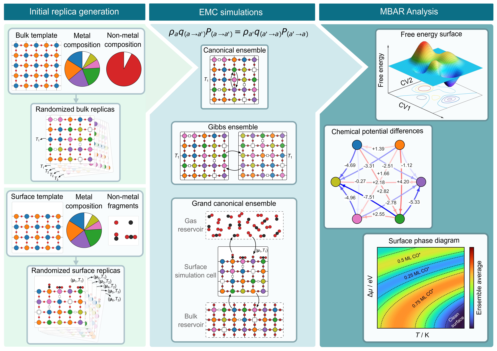
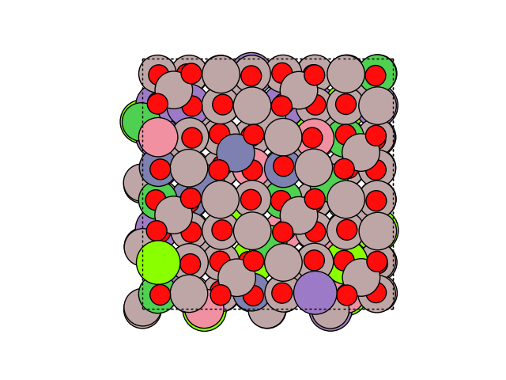
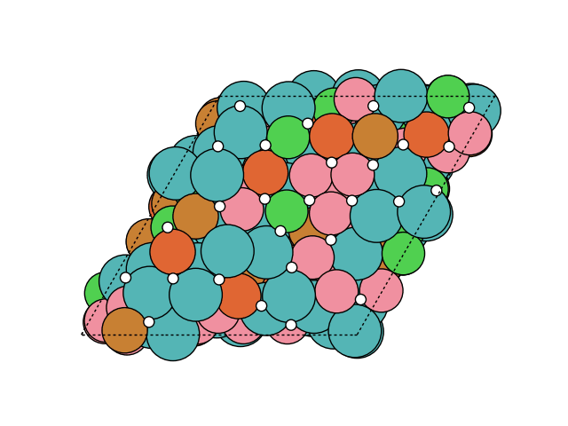
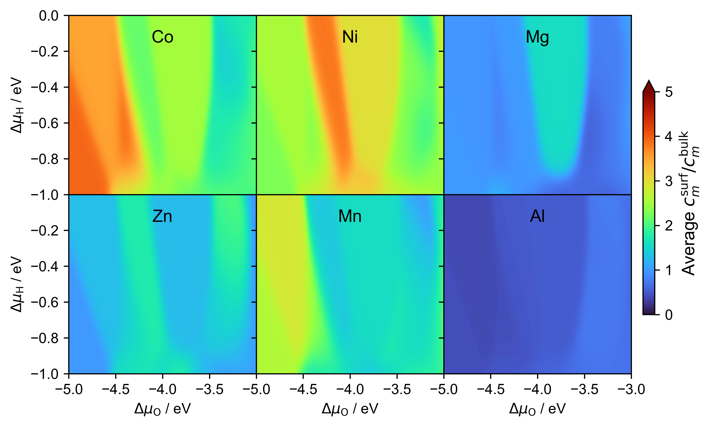
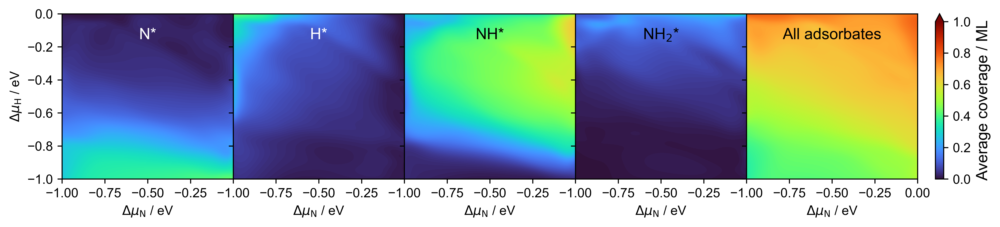

# CatEMC

**CatEMC** is a Python package for running evolutionary Monte Carlo (EMC) simulations for complex bulk/surface hetergeneous catalyst materials. The pacakge provides tools to (1) generate populations of structures and μ-windows, (2) run Gibbs ensemble evolutionary Monte Carlo (GE-EMC) bulk simulation at different temperatures, or run grand canonical evolutionary Monte Carlo (GC-EMC) simultions at different temperatures and reaction conditions, (3) analyze GE-EMC simulation data to estimate metal chemical potential differences, or analyze GC-EMC simulation data to estimate expectations of structural properties and free-energy surfaces. For more details please read the [CatEMC documentation](https://ShaunHan.github.io/CatEMC/).



---

## Author

Shuang Han: hanshuangshiren@gmail.com

---

## Quick start

Python environment: we recommend Python 3.9+ and a virtualenv or conda env. Install key packages used by the code:

   * `autoadsorbate`, `acat`, `ase`, `pymbar`

---

## Installation

If you plan to use the code directly from this repo, install in editable mode:

```bash
git clone https://github.com/basf/CatEMC.git
cd CatEMC
pip install -e .
```

---

## Workflow

A typical GC/GE-EMC campaign follows these steps:

1. **Generate structures** — make a diverse set of starting replicas, choose which atoms are mutable and randomize those atoms, then assign per-replica temperatures (and μ-windows to consider a range of reaction conditions).
2. **Run EMC** — launch GE-EMC for bulk simulation in the Gibbs ensemble or GC-EMC for surface simulation in the (extended) grand-canonical ensemble. The run will write ase.db backups every `trim_generation` steps.
3. **Postprocess** — use `catemc.analysis` to perform MBAR analysis of the bulk/surface configurations sampled from GE-EMC/GC-EMC simulations.
4. **Visualize** — convert `catemc.analysis` outputs (pickle files) into FES, heatmaps and phase diagrams.

---

## GE-EMC (bulk) — structure generation

Generates a set of `pop_size` initial on-lattice bulk replicas (`ase.Atoms`) that have their composition consistent with your target composition. The function `catemc.generate.generate_population()` can return a list of randomized `ase.Atoms` objects that suffices the requirement. You should save these to a structure file and inspect visually before running any production GE-EMC.

**Files required and produced**

* Input: a (relaxed) template structure file.
* Output: `*_input_pop.traj` containing `pop_size` numer of `ase.Atoms` with `atoms.info` set (`.info['key_value_pairs']['temperature']`).

**Practical tips**

* Set `pressure` to `None` if you want to run NVT GE-EMC, otherwise set to a common target `pressure` to run NPT GE-EMC which allows cell volume changes.
* Keep `pop_size` a multiple of number of temperatures / replicas you plan to use.

To generate an initial set of randomized surface structures (with adsorbates), you can use `catemc.generate.generate_population()` function:
```python
from catemc.generate import generate_population
from ase.io import read, write
from ase.visualize import view
import numpy as np

comp = 'Co0.2Ni0.2Mg0.2Zn0.2Mn0.2Al2O3.5'
structure = 'bulk'
cwd = f'/mnt/nfs/emc_tutorial/{comp}/{structure}'
target_metal_species = ['Co','Ni','Mg','Zn','Mn','Al']
target_metal_composition = {'Co': 0.2, 'Ni': 0.2, 'Mg': 0.2, 'Zn': 0.2, 'Mn': 0.2, 'Al': 2}
target_nonmetal_species = ['O', 'X']
target_nonmetal_composition = {'O': 3.5, 'X': 0.5}
template = read('Al2CoO4.cif')
cell = template.cell.copy()
for i in range(3):
    cell[i][i] = 8.06
template.set_cell(cell, scale_atoms=True)
template *= (2,2,2)
# Distinguish metal and oxygen atoms
metal_ids, oxygen_ids = [], []
for i, atom in enumerate(template):
    if atom.symbol == 'O':
        oxygen_ids.append(i)
    else:
        metal_ids.append(i)
metal_atoms, oxygen_atoms = template[metal_ids], template[oxygen_ids]
# Prepare sorted_ids for sorting atomic indices back to original order
sorted_ids = [0] * len(template)
for k, v in enumerate(metal_ids + oxygen_ids):
    sorted_ids[v] = k
bulk = (metal_atoms + oxygen_atoms)[sorted_ids] 

input_pop = generate_population(
    template=bulk,
    pop_size=24,
    target_metal_species=target_metal_species,
    target_metal_composition=target_metal_composition,
    target_nonmetal_species=target_nonmetal_species,
    target_nonmetal_composition=target_nonmetal_composition,
)
```
Now we can assign replica numbers and temperatures to these configurations:
```
# assign metadata (temperature/replica/emc step)
rep = 0
for T in [623, 723, 823, 923, 1023, 1123]:
    for _ in range(6):
        input_pop[rep].info = {'key_value_pairs': {}, 'data': {}}
        input_pop[rep].info['key_value_pairs']['temperature'] = T
        input_pop[rep].info['key_value_pairs']['replica'] = rep
        input_pop[rep].info['key_value_pairs']['emc_step'] = 0
        rep += 1

# Save and quick inspect
for img_idx, img in enumerate(input_pop):
    print(f"Replica {img_idx} → T = {img.info['key_value_pairs']['temperature']}")
view(input_pop)
write(f'{cwd}/{comp}_{structure}_input_pop.traj', input_pop)
```

---

## GE-EMC (bulk) — run simulation

Instantiates `GEEMC` and runs a bulk GE-EMC simulation. The `GEEMC` engine coordinates intraswap, interswap, crossover, replica exchange, and optional MD/relaxation with the calculators you specify inside the `calculation_script`.

**Files required**

* `*_input_pop.traj` — the initial population;
* `calculation_script` for calculating the fitness of each bulk structure.

**Practical tips**

* You must provide your own `calculation_script` (.py file) inside your `calculation_dir`. If you know what you are doing, you should make your own calculation script instead of using my `catemt.calculation_template` function.
* Use a repulsive potential if there are vacancies in your system to avoid generating high-energy structures when inserting atom at vacancy sites.
* Use multiple calculators if necessary.
* Set `fmax=None` if you don't want to perform energy minimization in each step.

```python
from catemc.geemc import GEEMC
from ase.io import read
import numpy as np
import sys, os

gpu_devices = [0]
ppg = 10
os.environ["CUDA_VISIBLE_DEVICES"] = str(gpu_devices[0])

comp = 'Co0.2Ni0.2Mg0.2Zn0.2Mn0.2Al2O3.5'
system_name = f'{comp}_bulk'
dir_name = f'/mnt/nfs/emc_tutorial/{comp}/bulk'
input_pop_fname = f'{dir_name}/{system_name}_input_pop.traj'
input_pop = read(input_pop_fname, index=':')

emc = GEEMC(system_name,
            calculation_dir=dir_name,
            calculation_script='calculate_fitness.py',
            input_pop=input_pop,
            fix_indices=None,
            trim_generation=100,
            pressure=0.,
            md_generation=10,
            exchange_generation=1,
            bias_starting_step=300,
            crossover_rate=0.1,
            metal_interswap_rate=0.5,
            nonmetal_interswap_rate=0.3,
            intraswap_rate=0.1,
            metal_element_pool=['Co','Ni','Mg','Zn','Mn','Al'],
            nonmetal_element_pool=['O','X'],
            raw_score_cutoff=-10000.,
            temperature_key='temperature',
            replica_key='replica',
            acceptance_key='accepted',
            gpu_devices=gpu_devices,
            procs_per_device=ppg)
emc.run(starting_step=1, total_steps=5000)
```
A template calculation script looks like this:

```python
from catemc.calculation_templates import calculate_bulk_fitness
from catemc.repulsive import RepulsivePotential
from mace.calculators.mace import MACECalculator
from ase import units
from ase.io import read, write
import numpy as np
import sys
import os

#======================Don't change this=====================
traj_path = sys.argv[1]
run_md = bool(int(sys.argv[2]))
gpu_device = sys.argv[3]
if sys.argv[4] == 'None':
    fix_indices = None
else:
    fix_indices = [int(i) for i in sys.argv[4].split(',')]
os.environ["CUDA_VISIBLE_DEVICES"] = str(gpu_device)
dir_name = '/'.join(traj_path.split('/')[:-1])
atoms = read(traj_path, index=-1)
atoms.wrap()
#============================================================

calc1 = RepulsivePotential()
fmax1 = 0.5
calc2 = MACECalculator(model_paths="/mnt/nfs/emc_tutorial/Co0.2Ni0.2Mg0.2Zn0.2Mn0.2Al2O3.5/models/CoNiMgZnMnAlCOH_mace.model",
                       dispersion=False, device='cuda', default_dtype='float64')
fmax2 = 0.05

calculate_bulk_fitness(
        atoms, traj_path=traj_path,
        calculator_list=[calc1, calc2],
        fmax_list=[fmax1, fmax2],
        target_metal_species=['Co','Ni','Mg','Zn','Mn','Al'],
        run_md=run_md,
        md_timestep=1*units.fs,
        md_taut=0.5*1000**units.fs,
        md_steps=400,
        md_write_interval=10,
        pressure=0.,
        md_taup=1000*units.fs,
        fix_indices=fix_indices,
        neighbor_cutoff=3.5,
        raw_score_cutoff=-10000.,
        temperature_key='temperature',
        replica_key='replica')
```

---

## GE-EMC (bulk) — MBAR analysis

Parses DB backups produced during GE-EMC, extracts Widom and potential energy samples, then computes chemical potential differences Δμ between all metal pairs using MBAR. Weighted least squares (WLS) can be used to correct the all pairwise Δμ estimates to suffice antisymmetry and transitivity.

**Files required and generated**

* Input: Existing DB backup files.
* Output: `*_mbar_data.pkl` and `*_mbar_widom_data.pkl` generated by `GEEMCAnalysis.prepare_data()` if files not present; `*_mbar_dmu_estimates.pkl` generated by `GEEMCAnalysis.get_dmu_estimates()`.

**Practical tips**

* Set `starting_step` to the step after burn-in when Δμ raw estimates have stabilized.
* If samples are highly correlated, increase `sample_stride` to reduce correlation.
* WLS correction needs enough directed Δμ entries to solve the Laplacian robustly.

```python
from catemc.analysis import GEEMCAnalysis
import pickle

system_name = 'Co0.2Ni0.2Mg0.2Zn0.2Mn0.2Al2O3.5_bulk'
dir_name = '/mnt/nfs/emc_tutorial/Co0.2Ni0.2Mg0.2Zn0.2Mn0.2Al2O3.5/bulk'
ana = GEEMCAnalysis(
        name=system_name,
        calculation_dir=dir_name,
        pop_size=48,
        target_metal_species=['Co','Ni','Mg','Zn','Mn','Al'],
        trim_generation=100,
        temperature_key='temperature',
        replica_key='replica',
        acceptance_key='accepted')

# Prepare data (reads DB backups; set use_exist=True to skip parsing)
ana.prepare_data(use_exist=True, raw_score_cutoff=-10000.)
# Compute dmu estimates (MBAR + WLS)
ana.get_dmu_estimates(starting_step=300, ending_step=1000, sample_stride=10,
                      target_temperatures=[723, 800, 823, 873, 950, 1023, 1100, 1173],
                      wls_correction=True)

with open(f'{dir_name}/{system_name}_mbar_dmu_estimates.pkl', 'rb') as handle:
    mbar_dmu_estimates = pickle.load(handle)
for T, d in mbar_dmu_estimates.items():
    print(T)
    print({k: round(v, 2) for k, v in d.items()})
```
Output:
```text
573
{'Co2Ni': 1.68, 'Co2Mg': 1.34, 'Co2Zn': 4.16, 'Co2Mn': -3.32, 'Co2Al': -1.21, 'Ni2Mg': -0.33, 'Ni2Zn': 2.48, 'Ni2Mn': -4.99, 'Ni2Al': -2.89, 'Mg2Zn': 2.81, 'Mg2Mn': -4.66, 'Mg2Al': -2.56, 'Zn2Mn': -7.48, 'Zn2Al': -5.37, 'Mn2Al': 2.1}
650
{'Co2Ni': 1.67, 'Co2Mg': 1.37, 'Co2Zn': 4.19, 'Co2Mn': -3.3, 'Co2Al': -1.11, 'Ni2Mg': -0.3, 'Ni2Zn': 2.52, 'Ni2Mn': -4.97, 'Ni2Al': -2.78, 'Mg2Zn': 2.82, 'Mg2Mn': -4.67, 'Mg2Al': -2.48, 'Zn2Mn': -7.49, 'Zn2Al': -5.3, 'Mn2Al': 2.2}
723
{'Co2Ni': 1.66, 'Co2Mg': 1.4, 'Co2Zn': 4.21, 'Co2Mn': -3.3, 'Co2Al': -1.09, 'Ni2Mg': -0.27, 'Ni2Zn': 2.54, 'Ni2Mn': -4.96, 'Ni2Al': -2.76, 'Mg2Zn': 2.81, 'Mg2Mn': -4.7, 'Mg2Al': -2.49, 'Zn2Mn': -7.51, 'Zn2Al': -5.3, 'Mn2Al': 2.21}
800
{'Co2Ni': 1.63, 'Co2Mg': 1.38, 'Co2Zn': 4.18, 'Co2Mn': -3.3, 'Co2Al': -1.12, 'Ni2Mg': -0.26, 'Ni2Zn': 2.55, 'Ni2Mn': -4.94, 'Ni2Al': -2.75, 'Mg2Zn': 2.81, 'Mg2Mn': -4.68, 'Mg2Al': -2.5, 'Zn2Mn': -7.49, 'Zn2Al': -5.3, 'Mn2Al': 2.18}
823
{'Co2Ni': 1.64, 'Co2Mg': 1.37, 'Co2Zn': 4.19, 'Co2Mn': -3.3, 'Co2Al': -1.09, 'Ni2Mg': -0.27, 'Ni2Zn': 2.55, 'Ni2Mn': -4.94, 'Ni2Al': -2.74, 'Mg2Zn': 2.82, 'Mg2Mn': -4.67, 'Mg2Al': -2.47, 'Zn2Mn': -7.49, 'Zn2Al': -5.28, 'Mn2Al': 2.21}
873
{'Co2Ni': 1.76, 'Co2Mg': 1.4, 'Co2Zn': 4.23, 'Co2Mn': -3.26, 'Co2Al': -1.01, 'Ni2Mg': -0.36, 'Ni2Zn': 2.46, 'Ni2Mn': -5.02, 'Ni2Al': -2.78, 'Mg2Zn': 2.83, 'Mg2Mn': -4.65, 'Mg2Al': -2.41, 'Zn2Mn': -7.48, 'Zn2Al': -5.24, 'Mn2Al': 2.24}
950
{'Co2Ni': 1.67, 'Co2Mg': 1.38, 'Co2Zn': 4.22, 'Co2Mn': -3.29, 'Co2Al': -1.06, 'Ni2Mg': -0.29, 'Ni2Zn': 2.54, 'Ni2Mn': -4.97, 'Ni2Al': -2.73, 'Mg2Zn': 2.84, 'Mg2Mn': -4.67, 'Mg2Al': -2.44, 'Zn2Mn': -7.51, 'Zn2Al': -5.28, 'Mn2Al': 2.23}
1023
{'Co2Ni': 1.7, 'Co2Mg': 1.36, 'Co2Zn': 4.2, 'Co2Mn': -3.3, 'Co2Al': -1.14, 'Ni2Mg': -0.35, 'Ni2Zn': 2.5, 'Ni2Mn': -5.0, 'Ni2Al': -2.84, 'Mg2Zn': 2.84, 'Mg2Mn': -4.65, 'Mg2Al': -2.5, 'Zn2Mn': -7.5, 'Zn2Al': -5.34, 'Mn2Al': 2.16}
1100
{'Co2Ni': 1.68, 'Co2Mg': 1.38, 'Co2Zn': 4.22, 'Co2Mn': -3.29, 'Co2Al': -1.13, 'Ni2Mg': -0.31, 'Ni2Zn': 2.54, 'Ni2Mn': -4.98, 'Ni2Al': -2.81, 'Mg2Zn': 2.85, 'Mg2Mn': -4.67, 'Mg2Al': -2.5, 'Zn2Mn': -7.51, 'Zn2Al': -5.35, 'Mn2Al': 2.17}
1173
{'Co2Ni': 1.73, 'Co2Mg': 1.39, 'Co2Zn': 4.24, 'Co2Mn': -3.29, 'Co2Al': -1.04, 'Ni2Mg': -0.33, 'Ni2Zn': 2.51, 'Ni2Mn': -5.02, 'Ni2Al': -2.77, 'Mg2Zn': 2.85, 'Mg2Mn': -4.69, 'Mg2Al': -2.44, 'Zn2Mn': -7.53, 'Zn2Al': -5.29, 'Mn2Al': 2.25}
1250
{'Co2Ni': 1.7, 'Co2Mg': 1.4, 'Co2Zn': 4.26, 'Co2Mn': -3.3, 'Co2Al': -1.01, 'Ni2Mg': -0.3, 'Ni2Zn': 2.56, 'Ni2Mn': -4.99, 'Ni2Al': -2.71, 'Mg2Zn': 2.86, 'Mg2Mn': -4.69, 'Mg2Al': -2.41, 'Zn2Mn': -7.56, 'Zn2Al': -5.27, 'Mn2Al': 2.28}
1323
{'Co2Ni': 1.65, 'Co2Mg': 1.4, 'Co2Zn': 4.3, 'Co2Mn': -3.28, 'Co2Al': -0.98, 'Ni2Mg': -0.25, 'Ni2Zn': 2.65, 'Ni2Mn': -4.93, 'Ni2Al': -2.63, 'Mg2Zn': 2.89, 'Mg2Mn': -4.68, 'Mg2Al': -2.38, 'Zn2Mn': -7.57, 'Zn2Al': -5.27, 'Mn2Al': 2.3}
1400
{'Co2Ni': 1.69, 'Co2Mg': 1.42, 'Co2Zn': 4.34, 'Co2Mn': -3.26, 'Co2Al': -1.0, 'Ni2Mg': -0.27, 'Ni2Zn': 2.65, 'Ni2Mn': -4.95, 'Ni2Al': -2.7, 'Mg2Zn': 2.92, 'Mg2Mn': -4.68, 'Mg2Al': -2.43, 'Zn2Mn': -7.6, 'Zn2Al': -5.35, 'Mn2Al': 2.26}
```
We can also get the GE-EMC trajectory of any replica by the following simple command, e.g. getting replica 10:
```
ana.get_trajectory(replica=10)
```
You can then visualize the trajectory with the name `*_geemc_10.traj`. Below shows a production trajectory for replica 10 of a spinel HEO bulk GE-EMC simulation:



---

## GC-EMC (surface) — structure generation (+ μ-window mapping)

Generates a set of `pop_size` initial on-lattice replicas for surface GC-EMC. It sorts candidate surface structures by C/O/H count and then assigns equal numbers of μ-grid points to each replica (the μ-window). The μ-window mapping ensures each replica explores a contiguous portion of the chemical potential space, and the higher chemical potential of each element is assigned to replicas with higher coverage of that element.

**Files required and produced**

* Input: a (relaxed) template structure file.
* Output: `*_input_pop.traj` containing `pop_size` number of `ase.Atoms` with `atoms.info` set (`.info['key_value_pairs']['temperature']`, `.info['data']['mu']` and `.info['data']['mu_window']`).

**Practical tips**

* Ensure surface `adsorption_sites` are correct (use `SlabAdsorptionSites` with `surface='autoadsorbate'` to identify adsorption sites on complex surfaces).
* Pay attention to the rounding of the μ-points.
  
To generate an initial set of randomized surface structures (with adsorbates), you can use `catemc.generate.generate_population()` function:
```python
from catemc.generate import generate_population
from acat.build import add_adsorbate_to_site
from acat.adsorption_sites import SlabAdsorptionSites
from ase.io import read, write
from ase.optimize import BFGS, LBFGS
from ase.visualize import view
import numpy as np
import random, pickle, math, sys, os

comp = 'Co0.2Ni0.2Mg0.2Zn0.2Mn0.2Al2O3.5'
surface = '311'
dir_name = f'/mnt/nfs/emc_tutorial/{comp}/{surface}'
template = read(f'{dir_name}/template_{comp}_{surface}_slab_mace_opt.traj')
fix_ids = [a.index for a in template if a.position[2] < 18.8]
mut_ids = [a.index for a in template if a.index not in fix_ids]
sas = SlabAdsorptionSites(template, surface='autoadsorbate',
                          composition_effect=False,
                          ignore_sites='bridge')

target_metal_species = ['Co','Ni','Mg','Zn','Mn','Al']
target_metal_composition = {'Co':0.2,'Ni':0.2,'Mg':0.2,'Zn':0.2,'Mn':0.2,'Al':2}
ads_species = ['O','H','OH','CO','CO2','CH','CH2','CH3']

# Generate candidate on-lattice structures
onlat_images = generate_population(
    template=template.copy(),
    pop_size=14,
    allowed_indices=mut_ids,
    target_metal_species=target_metal_species,
    target_metal_composition=target_metal_composition,
    target_nonmetal_species=None,
    target_nonmetal_composition=None,
    adsorbate_species=ads_species,
    adsorbate_adsorbate_dmin=2.,
    max_adsorbate_species=1,
    adsorption_sites=sas,
) + \
generate_population(
    template=template.copy(),
    pop_size=14,
    allowed_indices=mut_ids,
    target_metal_species=target_metal_species,
    target_metal_composition=target_metal_composition,
    target_nonmetal_species=['O','X'],
    target_nonmetal_composition={'O': 20, 'X': 1},
    adsorbate_species=ads_species,
    adsorbate_adsorbate_dmin=2.,
    max_adsorbate_species=1,
    adsorption_sites=sas,
) + \
generate_population(
    template=template.copy(),
    pop_size=14,
    allowed_indices=mut_ids,
    target_metal_species=target_metal_species,
    target_metal_composition=target_metal_composition,
    target_nonmetal_species=['O','X'],
    target_nonmetal_composition={'O': 10, 'X': 1},
    adsorbate_species=ads_species,
    adsorbate_adsorbate_dmin=2.,
    max_adsorbate_species=1,
    adsorption_sites=sas,
)
view(onlat_images)
```
To assign replica numbers, tempreatures and μ-windows to the input population, the μ-window assignment can be done by `catemc.generate.assign_mu_windows` function:
```python
from catemc.generate import assign_mu_windows
input_images = []
rep = 0
for T in [623, 723, 823]:
    for _ in range(14):
        atoms = onlat_images[rep]
        atoms.info = {'key_value_pairs': {}, 'data': {}}
        atoms.info['key_value_pairs']['temperature'] = T
        atoms.info['key_value_pairs']['replica'] = rep
        atoms.info['key_value_pairs']['emc_step'] = 0
        input_images.append(atoms)
        rep += 1

E_C = -9.944    # Etot per atom graphite PBE
E_O2 = -8.768 + 0.101   # Etot incl. ZPE PBE
E_H2 = -6.773 + 0.267   # Etot incl. ZPE PBE
dmu_C = np.arange(0., 2.001, 0.1)
dmu_O = np.arange(-4., -2.999, 0.1)
dmu_H = np.arange(-1., 0.001, 0.1)
# Mesh: first 3 cols = C, O, H 
grid = np.array(np.meshgrid(dmu_C, dmu_O, dmu_H)).T.reshape(-1, 3)

element_column_map = {'C': 0, 'O': 1, 'H': 2}
assigned_input_pop = assign_mu_windows(
        input_images, reaction_conditions=grid,
        element_column_map=element_column_map,
        round_decimals=3)

for img_idx, img in enumerate(assigned_input_pop):
    mu_rep = img.info['data']['mu']
    mu_window = img.info['data']['mu_window']
    T = img.info['key_value_pairs']['temperature']
    print(f'Replica {img_idx} → T = {T}, {len(mu_window)} μ-points in μ-window, currently {tuple(mu_rep)}')

view(assigned_input_pop)
write(f'{dir_name}/{comp}COH_{surface}_input_pop.traj', assigned_input_pop)
```

---

## GC-EMC (surface) — run simulation

Instantiates `GCEMC` and runs a surface GC-EMC simulation. The `GCEMC` engine coordinates intraswap, mutation, interswap, crossover, replica exchange, μ-walk, and optional MD/relaxation with the calculators you specify inside the `calculation_script`. `reaction_conditions` defines the range of reaction conditions that you want to consider in the GC-EMC.

**Files required**

* `*_input_pop.traj` — the initial population;
* `calculation_script` for calculating the fitness of each surface structure;
* `temperature_dmu_map` — mapping between temperature and the estimated chemical potential differences between all metal pairs (from GE-EMC MBAR analysis);
* `temperature_internal_map` — mapping between temperature and each possible adsorbate species and its internal partition function.

**Practical tips**

* You must provide your own `calculation_script` (.py file) inside your `calculation_dir`. If you know what you are doing, you should make your own calculation script instead of using my `catemt.calculation_template` function.
* Use a repulsive potential if there are vacancies in your system to avoid generating high-energy structures when inserting atom at vacancy sites.
* Use multiple calculators if necessary.
* Set `fmax=None` if you don't want to perform energy minimization in each step.
* Always use multi-try μ-walk instead of single-try.

```python
from catemc.gcemc import GCEMC
from ase.io import read, write
from acat.adsorption_sites import SlabAdsorptionSites
import numpy as np
import pickle, sys, os

gpu_devices = [int(di) for di in sys.argv[1].split(',')]
ppg = int(sys.argv[2])
os.environ["CUDA_VISIBLE_DEVICES"] = str(gpu_devices[0])

comp = 'Co0.2Ni0.2Mg0.2Zn0.2Mn0.2Al2O3.5'
system_name = f'{comp}COH_311'
dir_name = f'/mnt/nfs/emc_tutorial/{comp}/{surface}'
input_pop = read(f'{dir_name}/{system_name}_input_pop.traj', index=':')
template = read(f'{dir_name}/template_{comp}_{surface}_slab_mace_opt.traj')
target_metal_species = ['Co','Ni','Mg','Zn','Mn','Al']
target_metal_composition = {'Co':0.2,'Ni':0.2,'Mg':0.2,'Zn':0.2,'Mn':0.2,'Al':2}
target_nonmetal_species = ['O','X']
adsorbate_species = ['O','H','OH','CO','CO2','C','CH','CH2','CH3']
other_adsorbate_species = ['OH2','H2','O2','O2H','OOH','COH','CHO']
slab_indices = [a.index for a in template] 
fix_indices = [a.index for a in template if a.position[2] < 18.8]
mut_metal_indices = [a.index for a in template if (a.position[2] >= 18.8) and (a.symbol in target_metal_species)]
mut_nonmetal_indices = [a.index for a in template if (a.position[2] >= 18.8) and (a.symbol not in target_metal_species)]
volume = np.linalg.norm(np.cross(template.cell[0], template.cell[1])) * (15+2.5)
ct = Counter(template.symbols)
volume -= sum([n*4/3*math.pi*(data.covalent_radii[data.atomic_numbers[k]])**3
               for k, n in ct.items() if k in target_metal_species])

# Build reaction_conditions grid (mu_C, mu_O, mu_H, T)
E_C = -9.944    # Etot per atom graphite PBE
E_O2 = -8.768 + 0.101   # Etot incl. ZPE PBE
E_H2 = -6.773 + 0.267   # Etot incl. ZPE PBE
dmu_C = np.arange(0., 2.001, 0.1)
dmu_O = np.arange(-4., -2.999, 0.1)
dmu_H = np.arange(-1., 0.001, 0.1)
temperatures = sorted({atoms.info['key_value_pairs']['temperature'] for atoms in input_pop})
reaction_conditions = np.array(np.meshgrid(dmu_C, dmu_O, dmu_H, temperatures)).T.reshape(-1, 4)

element_column_map = {'C': 0, 'O': 1, 'H': 2}
element_eref_map = {'C': E_C., 'O': E_O2/2, 'H': E_H2/2}
element_y2x_map = {'C': 0., 'O': 3.5/3, 'H': 0.}
with open('/path/to/bulk_wls_dmu_estimates.pkl', 'rb') as f:
    tdmu_map = pickle.load(f)
with open(f'{dir_name}/COH_internal_data.pkl','rb') as handle:
    tsi_map = pickle.load(handle)
sas = SlabAdsorptionSites(template, surface='autoadsorbate', composition_effect=False, ignore_sites='bridge')

emc = GCEMC(system_name, calculation_dir=dir_name, calculation_script='calculate_fitness.py',
            input_pop=input_pop, fix_indices=fix_ids, trim_generation=100, md_generation=10,
            mu_walk_generation=1, exchange_generation=1, bias_starting_step=300,
            mbar_starting_step=100, mbar_sample_stride=10, crossover_rate=0.2,
            interswap_rate=0.1, slab_intraswap_rate=0.15, slab_mutation_rate=0.15,
            adsorbate_insertion_rate=0.1, adsorbate_removal_rate=0.1, adsorbate_displacement_rate=0.1,
            adsorbate_mutation_rate=0.1, adsorbate_surface_dmax=2.5, adsorbate_adsorbate_dmin=2.,
            max_adsorbate_species=3, max_adsorbate_coverage=1., metal_element_pool=target_metal_species,
            nonmetal_element_pool=['O','X'], bulk_metal_composition=target_metal_composition,
            adsorbate_species=adsorbate_species, mutable_metal_indices=mut_metal_indices,
            mutable_nonmetal_indices=mut_nonmetal_indices, slab_indices=slab_indices, volume=volume,
            reaction_conditions=reaction_conditions, element_column_map=element_column_map,
            element_eref_map=element_eref_map, element_y2x_map=element_y2x_map,
            temperature_dmu_map=tdmu_map, temperature_species_internal_map=tsi_map,
            adsorption_sites=sas, temperature_key='temperature', replica_key='replica',
            acceptance_key='accepted', raw_score_cutoff=-10000., gpu_devices=gpu_devices,
            procs_per_device=ppg)

emc.run(starting_step=1, total_steps=5000)
```
A template calculation script looks like this:
```
from catemc.calculation_templates import calculate_surface_fitness
from catemc.repulsive import RepulsivePotential
from mace.calculators.mace import MACECalculator
from ase import units
from ase.io import read, write
from ase.neighborlist import NeighborList
from ase.constraints import FixAtoms
from ase.optimize import BFGS, LBFGS
from ase.io.trajectory import Trajectory
from ase.md import Langevin
from ase.md.nvtberendsen import NVTBerendsen
from ase.md.nptberendsen import NPTBerendsen
from ase.md.velocitydistribution import MaxwellBoltzmannDistribution, Stationary
from acat.adsorption_sites import SlabAdsorptionSites
from acat.adsorbate_coverage import SlabAdsorbateCoverage
from acat.settings import adsorbate_elements
from itertools import combinations
import numpy as np
import pickle
import math
import sys
import os

#=====================Don't change this======================
traj_path = sys.argv[1]
run_md = bool(int(sys.argv[2]))
gpu_device = sys.argv[3]
if sys.argv[4] == 'None':
    fix_indices = None
else:
    fix_indices = [int(i) for i in sys.argv[4].split(',')]
if sys.argv[5] == 'None':
    slab_indices = None
else:
    slab_indices = [int(i) for i in sys.argv[5].split(',')]
os.environ["CUDA_VISIBLE_DEVICES"] = str(gpu_device)
dir_name = '/'.join(traj_path.split('/')[:-1])
atoms = read(traj_path, index=-1)
atoms.wrap()
#============================================================

calc1 = RepulsivePotential()
fmax1 = 0.5
calc2 = MACECalculator(model_paths="/mnt/nfs/ml_training/pretrained_mace_models/mace-mpa-0-medium.model",
                       dispersion=False, device='cuda', default_dtype='float64')
fmax2 = 0.25
calc3 = MACECalculator(model_paths="/mnt/nfs/emc_tutorial/Co0.2Ni0.2Mg0.2Zn0.2Mn0.2Al2O3.5/models/CoNiMgZnMnAlCOH_mace.model",
                       dispersion=False, device='cuda', default_dtype='float64')
fmax3 = 0.05
E_C = -9.944    # Etot per atom graphite PBE
E_O2 = -8.768 + 0.101   # Etot incl. ZPE PBE
E_H2 = -6.773 + 0.267   # Etot incl. ZPE PBE
rep = atoms.info['key_value_pairs']['replica']
site_path = f'{dir_name}/sites_{rep}.pkl'
try:
    with open(site_path, 'rb') as f:
        sas = pickle.load(f)
except:
    with open(f'/mnt/nfs/emc_tutorial/Co0.2Ni0.2Mg0.2Zn0.2Mn0.2Al2O3.5/311/Co0.2Ni0.2Mg0.2Zn0.2Mn0.2Al2O3.5_311_sites.pkl', 'rb') as f:
        sas = pickle.load(f)
with open(f'/mnt/nfs/emc_tutorial/Co0.2Ni0.2Mg0.2Zn0.2Mn0.2Al2O3.5/bulk/Co0.2Ni0.2Mg0.2Zn0.2Mn0.2Al2O3.5_bulk_wls_dmu_estimates.pkl', 'rb') as f:
    tdmu_map = pickle.load(f)
allowed_adsorbate_species = ['O','H','OH','OH2','H2','O2','O2H','OOH','C','CO','CO2','COH','CHO','CH','CH2','CH3']

calculate_surface_fitness(
        atoms, traj_path=traj_path,
        calculator_list=[calc1, calc2, calc3],
        fmax_list=[fmax1, fmax2, fmax3],
        target_metal_species=['Co','Ni','Mg','Zn','Mn','Al'],
        target_metal_composition={'Co':0.2,'Ni':0.2,'Mg':0.2,'Zn':0.2,'Mn':0.2,'Al':2},
        allowed_adsorbate_species=allowed_adsorbate_species,
        run_md=run_md,
        md_timestep=1*units.fs,
        md_taut=0.5*1000**units.fs,
        md_steps=400,
        md_write_interval=10,
        temperature_dmu_map=tdmu_map,
        element_column_map={'C': 0, 'O': 1, 'H': 2},
        element_eref_map={'C': E_C, 'O': E_O2/2, 'H': E_H2/2},
        element_y2x_map={'C': E_C, 'O': 3.5/3, 'H': 0.},
        adsorption_sites=sas,
        slab_indices=slab_indices,
        fix_indices=fix_indices,
        adsorbate_surface_dmax=2.5,
        neighbor_cutoff=2.5,
        raw_score_cutoff=-10000.,
        temperature_key='temperature',
        replica_key='replica')
```

---

## GC-EMC (surface) — MBAR analysis

Parses DB backups produced during GC-EMC, extracts potential energy samples, subsamples correlated series, then performs MBAR-based reweighting across your μ-grid, and computes structural expectations (adsorbate coverages, pair bond counts, vacancy concentration) at each reaction condition. 

**Files required and generated**

* Input: Existing DB backup files, `temperature_dmu_map` (from GE-EMC MBAR analysis);
* Output: `*_mbar_data.pkl` generated by `GCEMCAnalysis.prepare_data()` if file not present; `*_mbar_expectations.pkl`, `*_mbar.traj` and `*_sampled_indices.npy` generated by `GCEMCAnalysis.get_structural_expectations()`.

**Practical tips**

* Set `starting_step` to the step after burn-in when the biased μ-walk has been performed for sufficient number of steps.
* If samples are highly correlated, increase `sample_stride` to reduce correlation.

```python
from catemc.analysis import GCEMCAnalysis
from ase.io import read, write
import numpy as np, pickle

system_name = 'Co0.2Ni0.2Mg0.2Zn0.2Mn0.2Al2O3.5OH_311'
dir_name = '/path/to/output'
ana = GCEMCAnalysis(
        name=system_name,
        calculation_dir=dir_name,
        pop_size=48,
        target_metal_species=['Co','Ni','Mg','Zn','Mn','Al'],
        target_metal_composition={'Co':0.2,'Ni':0.2,'Mg':0.2,'Zn':0.2,'Mn':0.2,'Al':2},
        adsorbate_species=['O','H','OH'],
        trim_generation=100,
        temperature_key='temperature',
        replica_key='replica',
        acceptance_key='accepted')

ana.prepare_data(use_exist=True, raw_score_cutoff=-10000.)

E_O2 = -8.768 + 0.101   # Etot incl. ZPE PBE
E_H2 = -6.773 + 0.267   # Etot incl. ZPE PBE
dmu_O = np.arange(-5., -2.999, 0.02)
dmu_H = np.arange(-1.0, 0.001, 0.01)
sim_temperatures = [1023,]
reaction_conditions = np.array(np.meshgrid(dmu_O, dmu_H, sim_temperatures)).T.reshape(-1, 3)

with open('/path/to/bulk_wls_dmu_estimates.pkl','rb') as f:
    tdmu_map = pickle.load(f)
template = read(f'{dir_name}/template_Co0.2Ni0.2Mg0.2Zn0.2Mn0.2Al2O4_311_slab_mace_opt.traj')
z_surf = 24.
vac_indices = [a.index for a in template if a.symbol in ['O','X'] and (a.position[2] < z_surf)]

ana.get_structural_expectations(
        z_surf=z_surf,
        reaction_conditions=reaction_conditions,
        temperature_dmu_map=tdmu_map,
        element_column_map={'O': 0, 'H': 1},
        element_eref_map={'O': E_O2/2, 'H': E_H2/2},
        element_y2x_map={'O': 3.5/3, 'H': 0.},
        starting_step=500,
        ending_step=2000,
        sample_stride=50,
        vacancy_indices=vac_indices)
```
We can also get the GC-EMC trajectory of any replica by the following simple command, e.g. getting replica 10:
```
ana.get_trajectory(replica=10)
```
You can then visualize the trajectory with the name `*_gcemc_10.traj`. Below shows a production trajectory for replica 10 of an FCC HEA(111) surface GC-EMC simulation under ammonia decomposition condition:



## Visualizing results

To plot surface phase diagrams for certain structural properties, you can use the following script to e,g. visualize surface metal segregation:
```python
import matplotlib
import matplotlib.pyplot as plt
import matplotlib.ticker as mticker
from matplotlib.colors import ListedColormap
import seaborn as sns
import numpy as np
from ase.io import read, write
from ase.units import kB
from itertools import combinations
from collections import defaultdict
import pickle

matplotlib.rcParams.update(matplotlib.rcParamsDefault)
# Set font properties
from matplotlib import font_manager
font_path = '/mnt/nfs/source/arial.ttf'
font_manager.fontManager.addfont(font_path)
prop = font_manager.FontProperties(fname=font_path)
plt.rcParams['font.family'] = 'sans-serif'
plt.rcParams['font.sans-serif'] = prop.get_name()
plt.rcParams['text.usetex'] = False
plt.rcParams['svg.fonttype'] = 'none'

system_name = 'Co0.2Ni0.2Mg0.2Zn0.2Mn0.2Al2O3.5OH_311'
sim_temperatures = [1023,]
T = 1023
dmu_O = np.arange(-5., -2.999, 0.02)
dmu_H = np.arange(-1., 0.001, 0.01)
grid = np.array(np.meshgrid(dmu_O, dmu_H, sim_temperatures)).T.reshape(-1, 3)

with open(f'{system_name}_mbar_expectations.pkl', 'rb') as handle:
    expectations = pickle.load(handle)
# List of metal names for subtitles
metal_species = ['Co', 'Ni', 'Mg', 'Zn', 'Mn', 'Al']
metal_composition = {'Co':0.2/3,'Ni':0.2/3,'Mg':0.2/3,'Zn':0.2/3,'Mn':0.2/3,'Al':2/3}

# === Plotting ===
fig, axes = plt.subplots(2, 3, figsize=(7.3, 4.5), gridspec_kw = {'wspace':0, 'hspace':0})
axes_flat = axes.flatten()
# Uniform color scale
vmin, vmax = 0., 5.
levels = np.linspace(vmin, vmax, 6)

for i, ax in enumerate(axes_flat):
    m = metal_species[i]
    x_surf_avg = expectations[f'x_surf_{m}'] / metal_composition[m]

    # allocate Z with shape (Ny, Nx) since contourf expects rows->y (dmu_H), cols->x (dmu_O)
    Z = np.empty((len(dmu_O), len(dmu_H)), dtype=float)
    Z.fill(np.nan)
    # fill Z by matching mu_N, mu_H using np.isclose (robust to FP rounding)
    for iy, muH in enumerate(dmu_H):
        for ix, muO in enumerate(dmu_O):
            idx = np.where(np.isclose(grid[:,0], muO) & np.isclose(grid[:,1], muH) & np.isclose(grid[:,-1], T))[0]
            assert idx.size == 1
            Z[iy, ix] = x_surf_avg[idx[0]]
    Z[Z==0] = np.nan
    cmap = matplotlib.cm.turbo
    cmap.set_bad('lightgray')
    cf = ax.contourf(dmu_O, dmu_H, Z, levels=np.arange(vmin,vmax,1e-3), cmap=cmap, extend='max')
    cf.set_rasterized(True)
    ax.set_title(f'{m}', fontsize=12, y=0.8)
    if i in [3, 4, 5]:
        ax.set_xlabel(r'$\Delta \mu_{\rm{O}}$ / eV', fontsize=10)
    if i in [0, 3]:
        ax.set_ylabel(r'$\Delta \mu_{\rm{H}}$ / eV', fontsize=10)
    if i in [2, 5]:
        ax.set_xlim([-5, -3])
    else:
        ax.set_xlim([-5, -3.001])
    if i in [3, 4, 5]:
        ax.set_ylim([-1., -0.001])
    else:
        ax.set_ylim([-1, 0.])
    if i in [0, 1, 2]:
        ax.set_xticklabels([])
    if i not in [0, 3]:
        ax.set_yticklabels([])

# Create a single common colorbar
cbar = fig.colorbar(cf, ax=axes_flat.tolist(), orientation='vertical', fraction=0.02, pad=0.02)
cbar.ax.set_yticks([0., 1., 2., 3., 4., 5.])
cbar.set_label(r'Average $c_m^{\rm{surf}} / c_m^{\rm{bulk}}$', fontsize=12)

plt.show()
plt.clf()
```
Output:


You can use the following script to visualize adsorbate coverage in the surface phase diagram:
```python
import matplotlib
import matplotlib.pyplot as plt
import matplotlib.ticker as mticker
from matplotlib.colors import ListedColormap
import seaborn as sns
import numpy as np
from ase.io import read, write
from ase.units import kB
from itertools import combinations
from collections import defaultdict
import pickle

matplotlib.rcParams.update(matplotlib.rcParamsDefault)
# Set font properties
from matplotlib import font_manager
font_path = '/mnt/nfs/source/arial.ttf'
font_manager.fontManager.addfont(font_path)
prop = font_manager.FontProperties(fname=font_path)
plt.rcParams['font.family'] = 'sans-serif'
plt.rcParams['font.sans-serif'] = prop.get_name()
plt.rcParams['text.usetex'] = False
plt.rcParams['svg.fonttype'] = 'none'

system_name = 'Co0.25Mo0.45Fe0.1Ni0.1Cu0.1NH_111'
sim_temperatures = [573, 673, 773, 873]
T = 773
dmu_N = np.arange(-1., 0.001, 0.01)
dmu_H = np.arange(-1., 0.001, 0.01)
grid = np.array(np.meshgrid(dmu_N, dmu_H, sim_temperatures)).T.reshape(-1, 3)
with open(f'{system_name}_mbar_expectations.pkl', 'rb') as handle:
    expectations = pickle.load(handle)

# List of adsorbate names for subtitles
adsorbate_species = ['N', 'H', 'NH', 'NH2', 'all']

# === Plotting ===
fig, axes = plt.subplots(1, 5, figsize=(12.3, 2.3), gridspec_kw = {'wspace':0, 'hspace':0})
axes_flat = axes.flatten()

# Uniform color scale
vmin, vmax = 0., 1.
levels = np.linspace(vmin, vmax, 6)

for i, ax in enumerate(axes_flat):
    ads = adsorbate_species[i]
    if ads == 'all':
        ads_coverage_avg = expectations[f'ads_coverage']
    else:
        ads_coverage_avg = expectations[f'ads_coverage_{ads}']

    # allocate Z with shape (Ny, Nx) since contourf expects rows->y (dmu_H), cols->x (dmu_N)
    Z = np.empty((len(dmu_N), len(dmu_H)), dtype=float)
    Z.fill(np.nan)
    # fill Z by matching mu_N, mu_H using np.isclose (robust to FP rounding)
    for iy, muH in enumerate(dmu_H):
        for ix, muN in enumerate(dmu_N):
            idx = np.where(np.isclose(grid[:,0], muN) & np.isclose(grid[:,1], muH) & np.isclose(grid[:,-1], T))[0]
            assert idx.size == 1
            Z[iy, ix] = ads_coverage_avg[idx[0]]
    Z[Z==0] = np.nan
    cmap = matplotlib.cm.turbo
    cmap.set_bad('lightgray')
    cf = ax.contourf(dmu_N, dmu_H, Z, levels=np.arange(vmin,vmax,1e-3), cmap=cmap, extend='max')
    cf.set_rasterized(True)
    if ads in ['NH','all','NH2']:
        color = 'k'
    else:
        color = 'w'
    if ads == 'NH2':
        ads = r'NH$_2$*'
    elif ads == 'all':
        ads = 'All adsorbates'
    else:
        ads += '*'
    ax.set_title(ads, fontsize=12, y=0.8, color=color)
    ax.set_xlabel(r'$\Delta \mu_{\rm{N}}$ / eV', fontsize=10)
    if i in [0]:
        ax.set_ylabel(r'$\Delta \mu_{\rm{H}}$ / eV', fontsize=10)
    if i in [4]:
        ax.set_xlim([-1, 0.])
    else:
        ax.set_xlim([-1, -0.001])
    ax.set_ylim([-1, 0.])
    if i not in [0]:
        ax.set_yticklabels([])

# Create a single common colorbar
cbar = fig.colorbar(cf, ax=axes_flat.tolist(), orientation='vertical', fraction=0.02, pad=0.02)
cbar.ax.set_yticks([0.0, 0.2, 0.4, 0.6, 0.8, 1.0])
cbar.set_label('Average coverage / ML', fontsize=12)

plt.show()
plt.clf()
```
Output:

