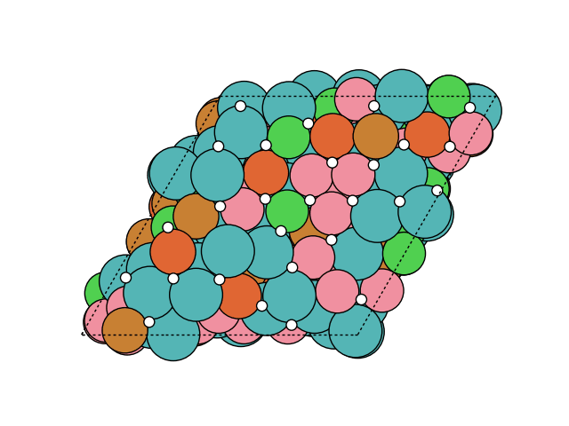

Post-simulation analyses
========================

A simulation writes every evaluated structure to ASE databases. The
analysis classes read these databases, reweight the samples with MBAR and
write the results as pickle files that are easy to plot.

.. list-table::
   :header-rows: 1
   :widths: 22 39 39

   * -
     - Bulk (canonical and Gibbs)
     - Surface (grand canonical)
   * - Python
     - :class:`catemc.analysis.GEEMCAnalysis`
     - :class:`catemc.analysis.GCEMCAnalysis`
   * - Command line
     - ``catemc analyze config.yaml``
     - ``catemc analyze config.yaml``
   * - Results
     - chemical-potential differences, short-range order
     - surface composition, coverages, bond statistics, vacancy fraction,
       free-energy surfaces
   * - For both
     - trajectories of single replicas, acceptance and correlation
       diagnostics
     -

Collecting the samples
----------------------

``prepare_data()`` collects the accepted structure of every replica at
every step, together with the Widom records of the Gibbs ensemble, and
caches them in ``{name}_mbar_data.pkl``, ``{name}_mbar_mc_data.pkl`` and
``{name}_mbar_widom_data.pkl``. Later analyses reuse the cache.

.. tab-set::
   :sync-group: interface

   .. tab-item:: Command line
      :sync: cli

      .. code-block:: console

         $ catemc analyze config.yaml           # reuse the cache
         $ catemc analyze config.yaml --fresh   # read the databases again

      Use ``--fresh`` after the simulation has been continued.

   .. tab-item:: Python
      :sync: python

      .. code-block:: python

         ana.prepare_data(use_exist=True)    # reuse the cache
         ana.prepare_data(use_exist=False)   # read the databases again

Three settings are shared by all analyses:

.. list-table::
   :header-rows: 1
   :widths: 24 76

   * - Setting
     - Meaning
   * - ``starting_step``
     - first step that is used. Everything before it is equilibration. In
       a surface run it must lie after ``bias_starting_step``.
   * - ``ending_step``
     - last step that is used (default: the last one)
   * - ``sample_stride``
     - use every this many steps, to reduce the correlation between
       samples

Chemical-potential differences
------------------------------

Theory
^^^^^^

**MBAR weights.** For the composite configuration :math:`\mathbf R =
\{\mathbf r_r\}` of the :math:`R_t` replicas at temperature state
:math:`t`, the dimensionless potential is

.. math::
   :label: eq-u-ge

   u_t(\mathbf R) = \beta_t \sum_r^{R_t} U_r(\mathbf r_r)

and MBAR gives the weight of a composite sample :math:`d`, drawn at any
temperature, for a target temperature state :math:`t`:

.. math::
   :label: eq-w-ge

   w_d^{(t)} = \frac{e^{\hat f_t - u_t(\mathbf R_d)}}
   {\sum_{t'}^{N_T} D_{t'}\, e^{\hat f_{t'} - u_{t'}(\mathbf R_d)}}

where :math:`D_{t'}` is the number of samples drawn at state :math:`t'`
and :math:`\hat f_t` the dimensionless free energy from the self-consistent
MBAR equations. The target temperature does not have to be one of the
simulated temperatures.

For a constant-pressure run the potential includes the volume terms of
:eq:`eq-rho-ge-npt`,

.. math::
   :label: eq-u-ge-npt

   u_t(\mathbf R, \{V_r\}) = \beta_t \sum_r^{R_t}
   \left[U_r(\mathbf r_r, V_r) + pV_r\right] - \sum_r^{R_t} N_r \ln V_r

**Pooling the Widom attempts.** A composite sample carries
:math:`A_d^{m\to n}` Widom attempts of turning :math:`m` into :math:`n`,
each with the observable

.. math::
   :label: eq-w-attempt

   W_{m\to n}^{(T)}(\mathbf r_{d,a}) = \frac{N_m}{N_n+1}\,
   e^{-\beta\Delta U_{m\to n}(\mathbf r_{d,a})}

The average over the attempts of one composite sample,

.. math::
   :label: eq-wbar

   \bar W_{m\to n}^{(T)}(\mathbf R_d) = \frac{1}{A_d^{m\to n}}
   \sum_a^{A_d^{m\to n}} W_{m\to n}^{(T)}(\mathbf r_{d,a})

is an observable of that sample, so MBAR provides its expectation and
variance at any temperature. This gives the raw estimate and, by the delta
method, its variance:

.. math::
   :label: eq-dmu-raw

   \widehat{\Delta\mu}_{m\to n}^{(T),\mathrm{raw}} =
   -\frac{1}{\beta}\ln\left\langle \bar W_{m\to n}^{(T)}\right\rangle,
   \qquad
   \mathrm{Var}\left(\widehat{\Delta\mu}_{m\to n}^{(T),\mathrm{raw}}\right)
   \approx \frac{\mathrm{Var}\left(\bar W_{m\to n}^{(T)}\right)}
   {\left(\beta\left\langle \bar W_{m\to n}^{(T)}\right\rangle\right)^2}

Because the total composition of each composite sample is fixed, the drift
in the composition of the individual replicas cancels when the attempts
are pooled.

**Weighted least-squares correction.** With finite sampling the raw
estimates are not exactly consistent. They should be antisymmetric,
:math:`\dmu{m}{n} = -\dmu{n}{m}`, and transitive,
:math:`\dmu{m}{n} = \dmu{m}{o} + \dmu{o}{n}`. Both hold automatically if
the differences derive from one set of potentials
:math:`\{\tilde\mu_m\}` with the reference :math:`\tilde\mu_1 = 0`. These
are determined by weighted least squares, with the inverse variances
:math:`\omega_{m\to n}` of the raw estimates as weights:

.. math::
   :label: eq-wls

   \min_{\tilde\mu_2,\ldots,\tilde\mu_M}
   \sum_{\substack{m,n\in\mathrm M\\ m\ne n}} \omega_{m\to n}
   \left(\tilde\mu_n - \tilde\mu_m -
   \widehat{\Delta\mu}_{m\to n}^{(T),\mathrm{raw}}\right)^2

The normal equations are a linear system :math:`\mathbf L
\tilde{\boldsymbol\mu} = \mathbf b` with the graph Laplacian

.. math::
   :label: eq-laplacian

   \begin{aligned}
   L_{ii} &= \sum_{j\ne i}\left(\omega_{i\to j} + \omega_{j\to i}\right),
   \qquad
   L_{ij} = -\left(\omega_{i\to j} + \omega_{j\to i}\right)\ (i\ne j) \\
   b_i &= \sum_{m\ne i}\omega_{m\to i}\,\widehat{\Delta\mu}_{m\to i}^{\mathrm{raw}}
       - \sum_{n\ne i}\omega_{i\to n}\,\widehat{\Delta\mu}_{i\to n}^{\mathrm{raw}}
   \end{aligned}

which is solved after removing the row and column of the reference
species. The corrected differences are
:math:`\widehat{\Delta\mu}_{m\to n} = \tilde\mu_n - \tilde\mu_m`. They are
the best linear unbiased estimates under the assumption of uncorrelated
errors. The correction enforces consistency. It cannot remove a
systematic bias of the sampling.

Usage
^^^^^

.. tab-set::
   :sync-group: interface

   .. tab-item:: Command line
      :sync: cli

      .. literalinclude:: ../../examples/Co0.25Mo0.45Fe0.1Ni0.1Cu0.1/bulk/config.yaml
         :language: yaml
         :start-at: analysis:

      .. code-block:: console

         $ catemc analyze config.yaml
         Metal chemical-potential differences mu_B - mu_A (eV), listed as 'A2B':
           573 K: Co2Mo ..., Co2Fe ..., Co2Ni ..., Co2Cu ..., Mo2Fe ..., ...
           ...
         Wrote Co0.25Mo0.45Fe0.1Ni0.1Cu0.1_bulk_mbar_dmu_estimates.pkl

   .. tab-item:: Python
      :sync: python

      .. literalinclude:: ../../examples/Co0.25Mo0.45Fe0.1Ni0.1Cu0.1/bulk/mbar_analysis.py
         :language: python

``target_temperatures`` may contain temperatures that were not simulated.
Include every temperature at which a surface simulation or its analysis
will need the bulk reservoir.

The result is a dictionary ``{temperature: {'A2B': value}}`` with
:math:`\mu_\mathrm{B} - \mu_\mathrm{A}` in eV for all pairs, in the order
of the metal list:

.. code-block:: python

   import pickle

   with open('Co0.25Mo0.45Fe0.1Ni0.1Cu0.1_bulk_mbar_dmu_estimates.pkl', 'rb') as handle:
       dmu = pickle.load(handle)
   dmu[800]['Co2Mo']      # mu_Mo - mu_Co at 800 K

.. list-table:: Options of ``get_dmu_estimates`` (``analysis.dmu``)
   :header-rows: 1
   :widths: 30 14 56

   * - Option
     - Default
     - Meaning
   * - ``target_temperatures``
     - simulated
     - temperatures to reweight to, in addition to the simulated ones
   * - ``simulation_temperatures``
     - all
     - use only the samples of these temperatures
   * - ``wls_correction``
     - ``True``
     - apply the weighted least-squares correction. With ``False`` the
       raw directed estimates and their weights are returned.
   * - ``excess_only``
     - ``False``
     - leave out the factor :math:`N_m/(N_n+1)` and return the excess part

Short-range order
-----------------

The Warren-Cowley parameter of a pair of species :math:`(m, n)` compares
the probability :math:`P_{mn}` of finding :math:`n` among the nearest
neighbours of :math:`m` with the concentration :math:`c_n`:

.. math::
   :label: eq-sro

   \alpha_{mn} = \frac{P_{mn} - c_n}{\delta_{mn} - c_n}

For unlike species this is :math:`1 - P_{mn}/c_n`: a negative value means
that :math:`m` and :math:`n` attract each other and a positive value that
they avoid each other. For like species (:math:`\delta_{mm} = 1`) a
positive value means clustering. A random alloy has
:math:`\alpha_{mn} = 0` for all pairs.

.. tab-set::
   :sync-group: interface

   .. tab-item:: Command line
      :sync: cli

      .. code-block:: yaml

         analysis:
           starting_step: 300
           sample_stride: 10
           sro: {cutoff: 3.5, use_energy_mask: true}

   .. tab-item:: Python
      :sync: python

      .. code-block:: python

         ana.get_sro(starting_step=300, ending_step=1000, sample_stride=10,
                     cutoff=3.5, metal_only=True, use_energy_mask=True)

``cutoff`` is the radius of the first neighbour shell in Å.
``metal_only=False`` includes the non-metal species. ``use_energy_mask``
skips the neighbour search for a replica whose energy did not change since
the previous step.

``{name}_sro_data.pkl`` holds ``{temperature: {(m, n): [array, ...]}}``
with one array per analysed step, containing :math:`\alpha_{mn}` of every
replica (``nan`` for replicas at other temperatures). The average over
steps and replicas is the short-range order at that temperature:

.. code-block:: python

   import numpy as np
   import pickle

   with open('Co0.25Mo0.45Fe0.1Ni0.1Cu0.1_bulk_sro_data.pkl', 'rb') as handle:
       sro = pickle.load(handle)
   for pair, arrays in sro[573].items():
       print(pair, np.nanmean(np.concatenate(arrays)))

Surface phase diagrams
----------------------

Theory
^^^^^^

For the surface simulations the dimensionless potential of a structure at
chemical-potential state :math:`s` and temperature state :math:`t` is
:math:`\phi_{s,t}(\mathbf r) = \beta_t\Phi_{s,t}(\mathbf r)` with the
reduced grand potential of :eq:`eq-phi`. MBAR solves self-consistently for
the dimensionless grand potential of every state,

.. math::
   :label: eq-f-gc

   \hat f_{s,t} = -\ln \sum_d^{D_\mathrm{tot}}
   \frac{e^{-\phi_{s,t}(\mathbf r_d)}}
   {\sum_{t'}^{N_T} D_{t'} \sum_{s'}^{S}
    e^{\hat f_{s',t'} - \phi_{s',t'}(\mathbf r_d)}}

and the weight of sample :math:`d` at a target state is

.. math::
   :label: eq-w-gc

   w_d^{(s,t)} = \frac{e^{\hat f_{s,t} - \phi_{s,t}(\mathbf r_d)}}
   {\sum_{t'}^{N_T} D_{t'} \sum_{s'}^{S}
    e^{\hat f_{s',t'} - \phi_{s',t'}(\mathbf r_d)}}

The expectation of any collective variable :math:`\chi`, such as a
coverage or a surface concentration, is then

.. math::
   :label: eq-expectation

   \langle\chi\rangle_{s,t} = \sum_d^{D_\mathrm{tot}} w_d^{(s,t)}\,
   \chi(\mathbf r_d)

The target state can be any reaction condition: a point of the simulated
grid, a point of a finer grid, or a temperature in between. Evaluating
:eq:`eq-expectation` over a grid of chemical potentials gives a surface
phase diagram.

Usage
^^^^^

.. tab-set::
   :sync-group: interface

   .. tab-item:: Command line
      :sync: cli

      .. literalinclude:: ../../examples/Co0.25Mo0.45Fe0.1Ni0.1Cu0.1/111/config.yaml
         :language: yaml
         :start-at: analysis:

      .. code-block:: console

         $ catemc analyze config.yaml

      The analysis reuses the chemical potentials, the reference energies,
      the reservoir and the internal partition functions of the
      simulation, so only the target conditions have to be given:

      * ``expectations.step`` refines the grid (0.025 eV here instead of
        the 0.05 eV of the simulation), and ``expectations.temperatures``
        adds temperatures.
      * ``conditions`` adds single reaction conditions. ``absolute: true``
        marks the values as absolute chemical potentials :math:`\mu_k`
        instead of :math:`\Delta\mu_k`.

      The expectations at the single conditions are printed:

      .. code-block:: text

         expectations: 8407 reaction conditions, saved to ..._mbar_expectations_conditions.npy
           condition [-0.3365, -0.707, 800.0]:
             x_surf_Co                ...
             x_surf_Mo                ...
             ads_coverage             ...
             ads_coverage_N           ...

   .. tab-item:: Python
      :sync: python

      .. literalinclude:: ../../examples/Co0.25Mo0.45Fe0.1Ni0.1Cu0.1/111/mbar_analysis.py
         :language: python
         :end-before: sim_dmu_N

      ``reaction_conditions`` has one row per target condition:
      :math:`\Delta\mu` of each element in the order of
      ``element_column_map``, then the temperature. When the conditions
      span more than one temperature, also pass
      ``temperature_species_internal_map`` and ``slab_indices`` of the
      simulation, so that the temperature dependence of the fragment
      weights in :eq:`eq-rho-gc` is included.

``{name}_mbar_expectations.pkl`` is a dictionary of arrays with one value
per reaction condition, in the order of ``reaction_conditions`` (which the
command line saves as ``{name}_mbar_expectations_conditions.npy``):

.. list-table::
   :header-rows: 1
   :widths: 34 66

   * - Key
     - Collective variable
   * - ``x_surf_Co``, ``x_surf_Mo``, ...
     - fraction of each metal among the surface metal atoms
   * - ``ads_coverage``
     - total coverage of adsorbates in monolayers
   * - ``ads_coverage_N``, ``ads_coverage_NH``, ...
     - coverage of each fragment
   * - ``Co-Mo``, ``Co-N``, ``N-H``, ``Co-Co``, ...
     - number of bonds of each pair of elements in the surface region
   * - ``x_lattice_vac``
     - fraction of vacant lattice sites (with ``vacancy_species`` or
       ``vacancy_indices``)

**Which atoms are surface atoms?** With ``z_surf`` every atom above that
height counts as a surface atom. Without it the surface atoms are detected
with AutoAdsorbate, which is the choice for rough or reconstructed
surfaces such as the HEO(311) example.

Example: HEO(311)
^^^^^^^^^^^^^^^^^

.. tab-set::
   :sync-group: interface

   .. tab-item:: Command line
      :sync: cli

      .. literalinclude:: ../../examples/Co0.2Ni0.2Mg0.2Zn0.2Mn0.2Al2O3.5/311/config_OH.yaml
         :language: yaml
         :start-at: analysis:

      ``vacancy_species: [O]`` adds the fraction of vacant lattice-oxygen
      sites to the results.

   .. tab-item:: Python
      :sync: python

      .. literalinclude:: ../../examples/Co0.2Ni0.2Mg0.2Zn0.2Mn0.2Al2O3.5/311/mbar_analysis_OH.py
         :language: python

Free-energy surfaces
--------------------

The grand potential of a surface phase :math:`i`, defined by the value
:math:`\chi_i` of a collective variable, is the free energy of observing
that value:

.. math::
   :label: eq-omega-chi

   \Omega_{T,p}(\chi_i) = -\frac{1}{\beta}\ln
   \frac{\int \delta\left(\chi_i - \chi(\mathbf r)\right)
   e^{-\beta\left(U(\mathbf r) - \sum_m N_m(\mathbf r)\mu_m^{(T)}
   - \sum_k N_k(\mathbf r)\mu_k^{(T,p)}\right)} d\mathbf r}
   {\int e^{-\beta\left(U(\mathbf r) - \sum_m N_m(\mathbf r)\mu_m^{(T)}
   - \sum_k N_k(\mathbf r)\mu_k^{(T,p)}\right)} d\mathbf r}

MBAR estimates it from the samples that fall into the bin of
:math:`\chi_i`:

.. math::
   :label: eq-fes

   \hat\Omega_{s,t}(\chi_i) = -\frac{1}{\beta}\ln \sum_d^{D_\mathrm{tot}}
   \frac{\delta\left(\chi_i - \chi(\mathbf r_d)\right)
   e^{-\phi_{s,t}(\mathbf r_d)}}
   {\sum_{t'}^{N_T} D_{t'} \sum_{s'}^{S}
    e^{\hat f_{s',t'} - \phi_{s',t'}(\mathbf r_d)}}

``get_structural_fes`` bins the samples by the surface metal fractions and
the adsorbate coverages together (``variable_keys=['all']``, the default)
or by any single collective variable, and assigns every sampled structure
the free energy of its bin at the requested conditions. The structure
with the lowest value is the most probable surface phase at that
condition.

.. tab-set::
   :sync-group: interface

   .. tab-item:: Command line
      :sync: cli

      .. code-block:: yaml

         analysis:
           conditions:
             - {N: -8.579, H: -3.960, T: 800, absolute: true}
             - {N: -9.167, H: -3.881, T: 800, absolute: true}
           fes:
             bin_width: 0.05

      The free energies are evaluated at the conditions listed under
      ``conditions``.

   .. tab-item:: Python
      :sync: python

      .. literalinclude:: ../../examples/Co0.25Mo0.45Fe0.1Ni0.1Cu0.1/111/mbar_analysis.py
         :language: python
         :start-at: sim_dmu_N

      ``sample_condition_indices`` selects the rows of
      ``reaction_conditions`` for which the free energies are evaluated,
      here the last two.

.. list-table:: Files of the surface analysis
   :header-rows: 1
   :widths: 40 60

   * - File
     - Content
   * - ``{name}_mbar_expectations.pkl``
     - expectations of the collective variables
   * - ``{name}_mbar_fes.pkl``
     - ``{'all': array}`` with one row per sampled structure and one
       column per reaction condition (``nan`` where not evaluated)
   * - ``{name}_mbar.traj``
     - the sampled structures, in the order of the rows above
   * - ``{name}_sampled_indices.npy``
     - indices of the structures that were kept after subsampling
   * - ``{name}_mbar_*_conditions.npy``
     - the reaction conditions of each task (command line)

Trajectories and diagnostics
----------------------------

.. tab-set::
   :sync-group: interface

   .. tab-item:: Command line
      :sync: cli

      .. code-block:: yaml

         analysis:
           trajectory: {replicas: [0, 10]}   # or "trajectory: true" for all
           diagnostics: true

   .. tab-item:: Python
      :sync: python

      .. code-block:: python

         ana.get_trajectory(replica=10)     # -> {name}_geemc_10.traj or {name}_gcemc_10.traj
         diagnostics = ana.get_diagnostics(starting_step=300)

``get_trajectory`` writes the accepted structures of one replica in order.
The file can be opened with ``ase gui``:

``get_diagnostics`` summarizes how well the run sampled, per replica, per
temperature and overall: the number of attempts and the acceptance ratio
of every move, and for bulk runs the statistical inefficiency :math:`g`,
the integrated correlation time and the effective number of samples of the
energy series. The result is returned and written to
``{name}_mbar_diagnostics.pkl``.

Is the run converged?
---------------------

* **Equilibration.** Plot the raw score, the coverages or the running
  estimate of :math:`\dmu{m}{n}` against the step and set
  ``starting_step`` after they have levelled off.
* **Correlation.** Increase ``sample_stride`` until the effective number
  of samples in the diagnostics no longer changes much. The published
  surface analyses use a stride of 50 steps.
* **Stability.** Repeat the analysis with a later ``starting_step`` or an
  earlier ``ending_step``. Results that change by more than their
  uncertainty call for a longer run.
* **Coverage of the grid.** In a surface run, the lines
  ``state k: n_k=..., kept=...`` of the analysis show how many samples
  each grid point received. Expectations far from any sampled state rely
  on extrapolation.
* **Both directions.** A chemical-potential difference needs Widom
  attempts in both directions of the pair. A pair with very few attempts
  in the window has an unreliable weight in the least-squares correction.
