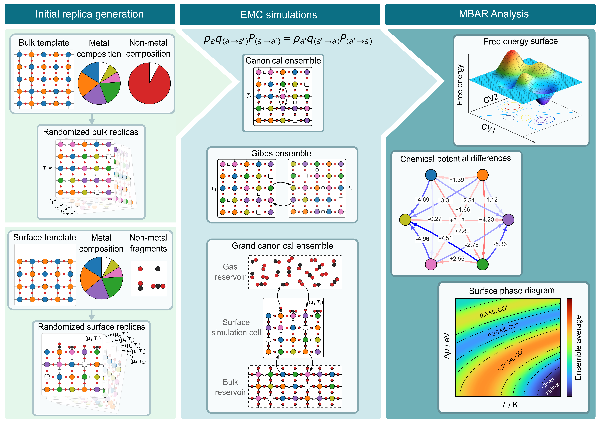

Method
======

This page explains the ideas that all CatEMC simulations share. The
tutorials then give the equations of each ensemble next to the code that
uses them.

A population of replicas
------------------------

Evolutionary Monte Carlo (EMC) evolves a *population* of
:math:`N_\mathrm{pop}` replicas of the same system instead of one structure.
The replicas are distributed over :math:`N_T` temperatures, with
:math:`R_T = N_\mathrm{pop} / N_T` replicas at each temperature. Two kinds
of moves act on this population:

* **Intra-moves** change one replica, as in ordinary Monte Carlo: swap two
  atoms, mutate an atom, insert or remove an adsorbate.
* **Inter-moves** act on two replicas at once: swap atoms between them,
  recombine them by a cut-and-splice crossover, or exchange their
  configurations (replica exchange). They let information flow through the
  population, which is why a population samples a rugged energy landscape
  much faster than independent walkers.

.. raw:: html

   

   <svg viewBox="0 0 900 330" width="900" role="img"
        aria-label="A population of replicas at four temperatures with three replicas each. Replicas at the same temperature swap atoms, replicas at different temperatures exchange configurations.">
     <defs>
       <marker id="pop-a" viewBox="0 0 10 10" refX="9" refY="5" markerWidth="6" markerHeight="6" orient="auto-start-reverse">
         <path d="M0 0 L10 5 L0 10 z" class="d-arrow"/>
       </marker>
     </defs>
     <!-- column headers -->
     <text class="d-text d-head" x="130" y="34" text-anchor="middle">T₁</text>
     <text class="d-text d-head" x="310" y="34" text-anchor="middle">T₂</text>
     <text class="d-text d-head" x="490" y="34" text-anchor="middle">T₃</text>
     <text class="d-text d-head" x="670" y="34" text-anchor="middle">T₄</text>
     <text class="d-muted d-small" x="130" y="52" text-anchor="middle">coldest</text>
     <text class="d-muted d-small" x="670" y="52" text-anchor="middle">hottest</text>
     <!-- replica boxes: 4 columns x 3 rows -->
     <g>
       <rect class="d-box" x="70" y="66" width="120" height="58" rx="10"/>
       <rect class="d-box" x="250" y="66" width="120" height="58" rx="10"/>
       <rect class="d-box" x="430" y="66" width="120" height="58" rx="10"/>
       <rect class="d-box" x="610" y="66" width="120" height="58" rx="10"/>
       <rect class="d-box" x="70" y="156" width="120" height="58" rx="10"/>
       <rect class="d-box" x="250" y="156" width="120" height="58" rx="10"/>
       <rect class="d-box" x="430" y="156" width="120" height="58" rx="10"/>
       <rect class="d-box" x="610" y="156" width="120" height="58" rx="10"/>
       <rect class="d-box" x="70" y="246" width="120" height="58" rx="10"/>
       <rect class="d-box" x="250" y="246" width="120" height="58" rx="10"/>
       <rect class="d-box" x="430" y="246" width="120" height="58" rx="10"/>
       <rect class="d-box" x="610" y="246" width="120" height="58" rx="10"/>
     </g>
     <!-- atoms in the replicas -->
     <g>
       <circle class="d-blue" cx="94" cy="95" r="8"/><circle class="d-orange" cx="112" cy="95" r="8"/><circle class="d-blue" cx="130" cy="95" r="8"/><circle class="d-aqua" cx="148" cy="95" r="8"/><circle class="d-violet" cx="166" cy="95" r="8"/>
       <circle class="d-orange" cx="94" cy="185" r="8"/><circle class="d-blue" cx="112" cy="185" r="8"/><circle class="d-aqua" cx="130" cy="185" r="8"/><circle class="d-blue" cx="148" cy="185" r="8"/><circle class="d-orange" cx="166" cy="185" r="8"/>
       <circle class="d-aqua" cx="94" cy="275" r="8"/><circle class="d-violet" cx="112" cy="275" r="8"/><circle class="d-blue" cx="130" cy="275" r="8"/><circle class="d-orange" cx="148" cy="275" r="8"/><circle class="d-blue" cx="166" cy="275" r="8"/>
       <circle class="d-violet" cx="274" cy="95" r="8"/><circle class="d-blue" cx="292" cy="95" r="8"/><circle class="d-orange" cx="310" cy="95" r="8"/><circle class="d-blue" cx="328" cy="95" r="8"/><circle class="d-aqua" cx="346" cy="95" r="8"/>
       <circle class="d-blue" cx="274" cy="185" r="8"/><circle class="d-aqua" cx="292" cy="185" r="8"/><circle class="d-blue" cx="310" cy="185" r="8"/><circle class="d-orange" cx="328" cy="185" r="8"/><circle class="d-violet" cx="346" cy="185" r="8"/>
       <circle class="d-orange" cx="274" cy="275" r="8"/><circle class="d-blue" cx="292" cy="275" r="8"/><circle class="d-violet" cx="310" cy="275" r="8"/><circle class="d-aqua" cx="328" cy="275" r="8"/><circle class="d-blue" cx="346" cy="275" r="8"/>
       <circle class="d-blue" cx="454" cy="95" r="8"/><circle class="d-aqua" cx="472" cy="95" r="8"/><circle class="d-orange" cx="490" cy="95" r="8"/><circle class="d-violet" cx="508" cy="95" r="8"/><circle class="d-blue" cx="526" cy="95" r="8"/>
       <circle class="d-aqua" cx="454" cy="185" r="8"/><circle class="d-orange" cx="472" cy="185" r="8"/><circle class="d-blue" cx="490" cy="185" r="8"/><circle class="d-blue" cx="508" cy="185" r="8"/><circle class="d-violet" cx="526" cy="185" r="8"/>
       <circle class="d-blue" cx="454" cy="275" r="8"/><circle class="d-violet" cx="472" cy="275" r="8"/><circle class="d-aqua" cx="490" cy="275" r="8"/><circle class="d-orange" cx="508" cy="275" r="8"/><circle class="d-blue" cx="526" cy="275" r="8"/>
       <circle class="d-orange" cx="634" cy="95" r="8"/><circle class="d-blue" cx="652" cy="95" r="8"/><circle class="d-violet" cx="670" cy="95" r="8"/><circle class="d-blue" cx="688" cy="95" r="8"/><circle class="d-aqua" cx="706" cy="95" r="8"/>
       <circle class="d-blue" cx="634" cy="185" r="8"/><circle class="d-orange" cx="652" cy="185" r="8"/><circle class="d-aqua" cx="670" cy="185" r="8"/><circle class="d-violet" cx="688" cy="185" r="8"/><circle class="d-blue" cx="706" cy="185" r="8"/>
       <circle class="d-violet" cx="634" cy="275" r="8"/><circle class="d-aqua" cx="652" cy="275" r="8"/><circle class="d-blue" cx="670" cy="275" r="8"/><circle class="d-blue" cx="688" cy="275" r="8"/><circle class="d-orange" cx="706" cy="275" r="8"/>
     </g>
     <!-- inter-swap: same temperature (vertical) -->
     <path class="d-accent-violet" d="M130 128 L130 152" marker-start="url(#pop-a)" marker-end="url(#pop-a)"/>
     <path class="d-accent-violet" d="M310 218 L310 242" marker-start="url(#pop-a)" marker-end="url(#pop-a)"/>
     <path class="d-accent-violet" d="M670 128 L670 152" marker-start="url(#pop-a)" marker-end="url(#pop-a)"/>
     <!-- exchange: neighbouring temperatures (horizontal) -->
     <path class="d-accent-aqua" d="M194 95 L246 95" marker-start="url(#pop-a)" marker-end="url(#pop-a)"/>
     <path class="d-accent-aqua" d="M374 185 L426 185" marker-start="url(#pop-a)" marker-end="url(#pop-a)"/>
     <path class="d-accent-aqua" d="M554 275 L606 275" marker-start="url(#pop-a)" marker-end="url(#pop-a)"/>
     <!-- legend -->
     <path class="d-accent-violet" d="M770 96 L800 96"/>
     <text class="d-text d-small" x="808" y="92">inter-swap</text>
     <text class="d-muted d-small" x="808" y="108">same T, atoms</text>
     <path class="d-accent-aqua" d="M770 150 L800 150"/>
     <text class="d-text d-small" x="808" y="146">exchange</text>
     <text class="d-muted d-small" x="808" y="162">other T,</text>
     <text class="d-muted d-small" x="808" y="178">whole structure</text>
     <rect class="d-box" x="770" y="208" width="30" height="20" rx="5"/>
     <text class="d-text d-small" x="808" y="218">one replica</text>
     <text class="d-muted d-small" x="808" y="234">intra-moves, MD</text>
   </svg>
   

Off-lattice sampling with a machine-learning potential
------------------------------------------------------

CatEMC does not use a lattice model. After every move the structure is
relaxed with a machine-learning interatomic potential (MLIP), and the relaxed
energy enters the acceptance probability. Every ``md_generation`` steps all
replicas are also propagated by a short molecular-dynamics (MD) run at their
temperature, so that the population can leave the basin it relaxed into.
One *cycle* of the published simulations is one MD run of 400 fs followed
by ten EMC steps.

.. raw:: html

   

   <svg viewBox="0 0 900 150" width="900" role="img"
        aria-label="One EMC step: propose a move for every replica, relax, accept or reject, exchange replicas, and molecular dynamics every md_generation steps">
     <defs>
       <marker id="st-a" viewBox="0 0 10 10" refX="9" refY="5" markerWidth="7" markerHeight="7" orient="auto">
         <path d="M0 0 L10 5 L0 10 z" class="d-arrow"/>
       </marker>
     </defs>
     <rect class="d-box" x="10" y="30" width="150" height="86" rx="10"/>
     <rect class="d-blue" x="10" y="30" width="150" height="5" rx="2.5"/>
     <text class="d-text d-head" x="85" y="64" text-anchor="middle">Propose</text>
     <text class="d-muted d-small" x="85" y="84" text-anchor="middle">one move per replica</text>
     <text class="d-muted d-small" x="85" y="100" text-anchor="middle">chosen by its rate</text>
     <rect class="d-box" x="192" y="30" width="150" height="86" rx="10"/>
     <rect class="d-blue" x="192" y="30" width="150" height="5" rx="2.5"/>
     <text class="d-text d-head" x="267" y="64" text-anchor="middle">Relax</text>
     <text class="d-muted d-small" x="267" y="84" text-anchor="middle">calculators in sequence,</text>
     <text class="d-muted d-small" x="267" y="100" text-anchor="middle">in parallel workers</text>
     <rect class="d-box" x="374" y="30" width="150" height="86" rx="10"/>
     <rect class="d-violet" x="374" y="30" width="150" height="5" rx="2.5"/>
     <text class="d-text d-head" x="449" y="64" text-anchor="middle">Accept or reject</text>
     <text class="d-muted d-small" x="449" y="84" text-anchor="middle">Metropolis criterion</text>
     <text class="d-muted d-small" x="449" y="100" text-anchor="middle">of the ensemble</text>
     <rect class="d-box" x="556" y="30" width="150" height="86" rx="10"/>
     <rect class="d-aqua" x="556" y="30" width="150" height="5" rx="2.5"/>
     <text class="d-text d-head" x="631" y="64" text-anchor="middle">Exchange</text>
     <text class="d-muted d-small" x="631" y="84" text-anchor="middle">replica exchange,</text>
     <text class="d-muted d-small" x="631" y="100" text-anchor="middle">μ-walk (surfaces)</text>
     <rect class="d-box" x="738" y="30" width="150" height="86" rx="10"/>
     <rect class="d-orange" x="738" y="30" width="150" height="5" rx="2.5"/>
     <text class="d-text d-head" x="813" y="64" text-anchor="middle">MD</text>
     <text class="d-muted d-small" x="813" y="84" text-anchor="middle">every md_generation</text>
     <text class="d-muted d-small" x="813" y="100" text-anchor="middle">steps</text>
     <path class="d-line" d="M162 73 L188 73" marker-end="url(#st-a)"/>
     <path class="d-line" d="M344 73 L370 73" marker-end="url(#st-a)"/>
     <path class="d-line" d="M526 73 L552 73" marker-end="url(#st-a)"/>
     <path class="d-line" d="M708 73 L734 73" marker-end="url(#st-a)"/>
     <path class="d-line" d="M813 118 L813 138 L85 138 L85 120" marker-end="url(#st-a)"/>
   </svg>
   

Detailed balance
----------------

Every move is accepted with a Metropolis probability that follows from
detailed balance with respect to the target distribution :math:`\rho` of the
ensemble. For a move of one replica from state :math:`a` to :math:`a'`,

.. math::
   :label: eq-balance-one

   \rho_a \, q_{(a\to a')} \, P_{(a\to a')} =
   \rho_{a'} \, q_{(a'\to a)} \, P_{(a'\to a)}

where :math:`q` is the probability of proposing the move and :math:`P` the
probability of accepting it. For a move of two replicas :math:`a` and
:math:`b`,

.. math::
   :label: eq-balance-two

   \rho_a \rho_b \, q_{((a,b)\to (a',b'))} \, P_{((a,b)\to (a',b'))} =
   \rho_{a'} \rho_{b'} \, q_{((a',b')\to (a,b))} \, P_{((a',b')\to (a,b))}

The Metropolis choice is

.. math::
   :label: eq-metropolis

   P_{(a\to a')} = \min\left[1,
   \frac{\rho_{a'} \, q_{(a'\to a)}}{\rho_a \, q_{(a\to a')}}\right]

with the joint-density ratio for a two-replica move. The three ensembles
differ only in :math:`\rho` and in the set of moves, so each tutorial lists
the resulting acceptance probabilities.

Three ensembles
---------------

.. list-table::
   :header-rows: 1
   :widths: 16 28 28 28

   * -
     - Canonical
     - Gibbs
     - Grand canonical
   * - Class
     - :class:`~catemc.emc.EMC`
     - :class:`~catemc.geemc.GEEMC`
     - :class:`~catemc.gcemc.GCEMC`
   * - ``ensemble:``
     - ``canonical``
     - ``gibbs``
     - ``grand_canonical``
   * - System
     - bulk (or any closed system)
     - bulk
     - surface in contact with a bulk and a gas reservoir
   * - Conserved
     - composition of every replica
     - total composition of the replicas at each temperature
     - temperature and chemical potentials
   * - Extra moves
     - none
     - inter-swap of atoms between replicas
     - mutation, adsorbate insertion and removal, μ-walk
   * - Main result
     - equilibrium ordering at fixed composition
     - :math:`\dmu{m}{n}` between all metals as a function of :math:`T`
     - surface composition and coverage as functions of :math:`T` and
       :math:`\{\mu_k\}`
   * - Tutorial
     - :doc:`canonical_emc`
     - :doc:`bulk_geemc`
     - :doc:`surface_gcemc`

**Canonical ensemble.** Every replica keeps its composition. The replicas
only differ in temperature, and replica exchange carries low-energy
arrangements from the hot to the cold replicas.

**Gibbs ensemble.** Replicas at the same temperature exchange atoms, so the
composition of a single replica fluctuates while the total composition at
each temperature is conserved. Every attempted exchange is a Widom test of
the cost of turning a metal :math:`m` into a metal :math:`n`, which gives the
chemical-potential differences :math:`\dmu{m}{n} = \mu_n - \mu_m` in one run.
This is a semi-grand-canonical simulation in reverse: the composition is
imposed and the chemical potentials are measured.

**Grand-canonical ensemble.** A slab exchanges metal atoms with the bulk
below it and non-metal atoms with the gas above it. The chemical potentials
of the metals come from the Gibbs-ensemble run of the bulk, and those of the
non-metals from the reaction conditions. In the *extended* grand-canonical
ensemble the non-metal chemical potentials are sampled too, so that one run
covers a whole grid of reaction conditions.

From bulk to surface
--------------------

A complete study therefore has two simulations that feed into each other:

1. The **bulk Gibbs-ensemble** simulation gives :math:`\dmu{m}{n}^{(T)}` for
   all metal pairs at the temperatures of interest.
2. The **surface grand-canonical** simulation uses these values as its bulk
   reservoir, together with the chemical potentials of the gas phase.

Reweighting with MBAR
---------------------

The replicas sample a finite set of thermodynamic states: temperatures in
the bulk simulations, and temperatures combined with chemical potentials in
the surface simulations. The multistate Bennett acceptance ratio (MBAR)
method pools the samples of all states and assigns each sample :math:`d` a
weight :math:`w_d^{(t)}` for any target state :math:`t`, whether it was
simulated or not:

.. math::
   :label: eq-mbar-weight

   w_d^{(t)} = \frac{e^{\hat f_t - u_t(\mathbf{R}_d)}}
   {\sum_{t'} D_{t'} \, e^{\hat f_{t'} - u_{t'}(\mathbf{R}_d)}}

Here :math:`u_t` is the dimensionless potential of state :math:`t`,
:math:`D_{t'}` the number of samples drawn from state :math:`t'` and
:math:`\hat f_t` the dimensionless free energy that MBAR determines
self-consistently. The expectation of any observable :math:`\chi` at the
target state is :math:`\langle\chi\rangle_t = \sum_d w_d^{(t)} \chi_d`.
:doc:`analysis` shows how this gives chemical potentials, surface phase
diagrams and free-energy surfaces.

Notation
--------

.. list-table::
   :header-rows: 1
   :widths: 22 78

   * - Symbol
     - Meaning
   * - :math:`\beta = 1/(\kB T)`
     - reciprocal temperature
   * - :math:`U(\mathbf r)`
     - potential energy of the relaxed structure
   * - :math:`\Delta U = U(\mathbf r') - U(\mathbf r)`
     - energy change caused by a move
   * - :math:`\dmu{m}{n} = \mu_n - \mu_m`
     - chemical-potential difference between metals :math:`m` and :math:`n`
   * - :math:`\mathrm{M}`, :math:`\NM`
     - the sets of metal and non-metal species
   * - :math:`c_m`, :math:`c_m^\mathrm{bulk}`
     - mole fraction of metal :math:`m` in the structure and in the bulk
   * - :math:`\Phi_{s,t}(\mathbf r)`
     - reduced grand potential at chemical-potential state :math:`s` and
       temperature state :math:`t`
   * - :math:`\hat f`
     - dimensionless free energy estimated by MBAR

Reference
---------

The method, its derivations and its applications are described in

   S. Han, S. De *et al.*, *Machine learning-accelerated evolutionary Monte
   Carlo for rapid phase exploration of compositionally complex materials in
   reactive environments* (manuscript and Supplementary Information).

The equations in this documentation follow the notation of that paper.
