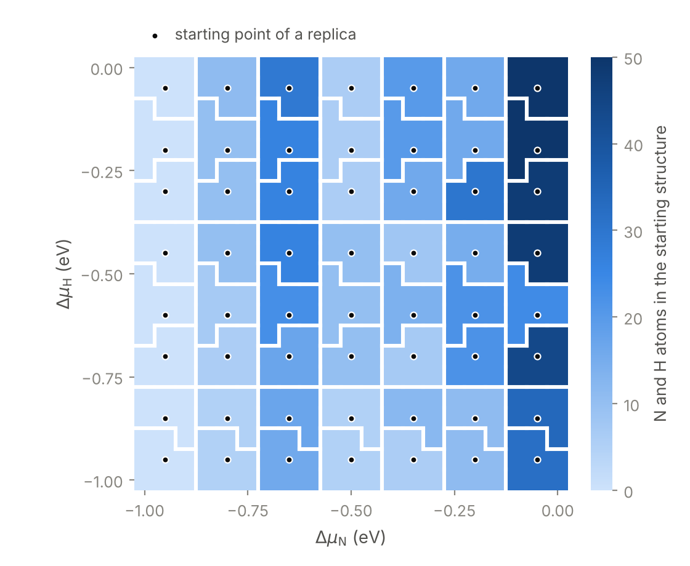
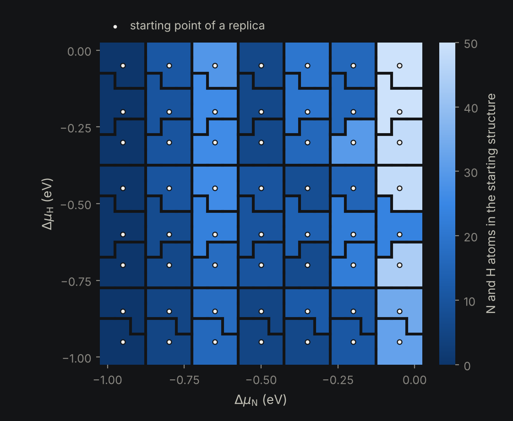

Structure generation
====================

Every simulation starts from an *initial population*: one structure per
replica, each labelled with its temperature and, for surfaces, with the part
of the chemical-potential grid it will sample. This tutorial builds the
populations of the four example systems.

.. list-table::
   :header-rows: 1
   :widths: 30 70

   * - Python
     - :func:`catemc.generate.generate_population`,
       :func:`catemc.generate.assign_mu_windows`
   * - Command line
     - ``catemc generate config.yaml`` (sections ``composition``,
       ``template``, ``regions`` and ``population``)
   * - Output
     - ``{name}_input_pop.traj``, and ``{name}_template.traj`` from the
       command line

What a population contains
--------------------------

A population is a list of :class:`ase.Atoms` objects. CatEMC reads the
labels of each replica from ``atoms.info``:

.. code-block:: python

   atoms.info = {
       'key_value_pairs': {
           'temperature': 573,     # K
           'replica': 0,           # index of the replica
           'emc_step': 0,
       },
       'data': {
           # surfaces only (written by assign_mu_windows):
           'mu': (-0.45, -0.15),            # current point of the mu-grid
           'mu_window': [(-0.5, -0.2), ...] # the points this replica may visit
       },
   }

The temperatures form a staircase: :math:`N_T` temperatures with
:math:`R_T = N_\mathrm{pop}/N_T` replicas each. Several replicas per
temperature are required for the Gibbs ensemble, where replicas at the same
temperature exchange atoms, and they improve the sampling in the other two
ensembles.

.. tip::

   Choose the temperatures so that neighbouring ones overlap in energy,
   otherwise replica exchange is rarely accepted. A spacing of 50 to 100 K
   works for the systems of this tutorial. The lowest temperature should be
   the lowest one you want results for, because MBAR interpolates between
   the simulated temperatures much better than it extrapolates beyond them.

Composition, sublattices and vacancies
--------------------------------------

CatEMC describes a material :math:`\{\mathrm{M}\}_x\{\NM\}_y` by two
sublattices: the *metal* sites, shared by the :math:`M` metal species, and
the *non-metal* sites. A vacancy is a species of its own with the symbol
``X``. It is kept in the structure as a pseudo-atom so that the indices of
all atoms stay the same when a vacancy is created or filled, and it is
removed whenever energies and forces are calculated.

The composition is normalized on each sublattice separately, so the numbers
only have to be proportional to the amounts:

.. tab-set::
   :sync-group: interface

   .. tab-item:: Command line
      :sync: cli

      .. code-block:: yaml

         # one formula; elements are sorted into metals and non-metals
         composition: Co0.2Ni0.2Mg0.2Zn0.2Mn0.2Al2O3.5X0.5

         # or the two sublattices explicitly
         composition:
           metals: {Co: 0.2, Ni: 0.2, Mg: 0.2, Zn: 0.2, Mn: 0.2, Al: 2}
           nonmetals: {O: 3.5, X: 0.5}

   .. tab-item:: Python
      :sync: python

      .. code-block:: python

         target_metal_species = ['Co', 'Ni', 'Mg', 'Zn', 'Mn', 'Al']
         target_metal_composition = {'Co': 0.2, 'Ni': 0.2, 'Mg': 0.2,
                                     'Zn': 0.2, 'Mn': 0.2, 'Al': 2}
         target_nonmetal_species = ['O', 'X']
         target_nonmetal_composition = {'O': 3.5, 'X': 0.5}

The numbers of atoms are rounded to integers that add up to the number of
sites. In the 448-site spinel cell used below, the formula above becomes
Al\ :sub:`128`\ Co\ :sub:`13`\ Mg\ :sub:`13`\ Mn\ :sub:`12`\ Ni\ :sub:`13`\
Zn\ :sub:`13`\ O\ :sub:`224`\ X\ :sub:`32`.

Bulk populations
----------------

HEA bulk
^^^^^^^^

The alloy is a random decoration of an fcc lattice with the experimental
lattice constant: an 8×8×8 cell with 512 atoms and 48 replicas at twelve
temperatures between 573 and 1400 K.

.. tab-set::
   :sync-group: interface

   .. tab-item:: Command line
      :sync: cli

      .. literalinclude:: ../../examples/Co0.25Mo0.45Fe0.1Ni0.1Cu0.1/bulk/config.yaml
         :language: yaml
         :start-at: name:
         :end-before: calculators:

      .. code-block:: console

         $ cd examples/Co0.25Mo0.45Fe0.1Ni0.1Cu0.1/bulk
         $ catemc generate config.yaml

   .. tab-item:: Python
      :sync: python

      .. literalinclude:: ../../examples/Co0.25Mo0.45Fe0.1Ni0.1Cu0.1/bulk/generate_initial_population.py
         :language: python

``template.build`` accepts any function of ``ase.build`` together with
its arguments, so ``bulk``, ``fcc111``, ``surface``, ``mx2`` and all other
builders are available without writing Python.

HEO bulk with oxygen vacancies
^^^^^^^^^^^^^^^^^^^^^^^^^^^^^^

The spinel template is read from a structure file. Co and Al of the file
mark the metal sites, which are then decorated with the six metals, and one
eighth of the oxygen sites is turned into vacancies.

.. tab-set::
   :sync-group: interface

   .. tab-item:: Command line
      :sync: cli

      .. literalinclude:: ../../examples/Co0.2Ni0.2Mg0.2Zn0.2Mn0.2Al2O3.5/bulk/config.yaml
         :language: yaml
         :start-at: name:
         :end-before: # The repulsive potential

      .. code-block:: console

         $ cd examples/Co0.2Ni0.2Mg0.2Zn0.2Mn0.2Al2O3.5/bulk
         $ catemc generate config.yaml
         Replica   0  T = 723 K  Al128Co13Mg13Mn12Ni13O224X32Zn13
         Replica   1  T = 723 K  Al128Co13Mg13Mn12Ni13O224X32Zn13
         ...
         Wrote 24 replicas to Co0.2Ni0.2Mg0.2Zn0.2Mn0.2Al2O3.5_bulk_input_pop.traj

   .. tab-item:: Python
      :sync: python

      .. literalinclude:: ../../examples/Co0.2Ni0.2Mg0.2Zn0.2Mn0.2Al2O3.5/bulk/generate_initial_population.py
         :language: python

Populations for the canonical ensemble
^^^^^^^^^^^^^^^^^^^^^^^^^^^^^^^^^^^^^^

The canonical ensemble uses exactly the same populations. Because no atoms
are exchanged between replicas, every replica keeps the composition it
starts with, including the oxygen-vacancy concentration of the HEO. The
``config_canonical.yaml`` files of the two bulk folders therefore only differ
from ``config.yaml`` in the ``name``, the ``ensemble`` and the move rates
(see :doc:`canonical_emc`).

Surface populations
-------------------

A surface population needs three more ingredients: the region of the slab
that is allowed to change, a set of adsorbates, and the μ-windows.

Regions of the slab
^^^^^^^^^^^^^^^^^^^

.. list-table::
   :header-rows: 1
   :widths: 28 30 42

   * - Region
     - Python argument
     - Meaning
   * - ``regions.fixed``
     - ``fix_indices``
     - atoms that are frozen during relaxation and MD and never mutate
   * - ``regions.mutable_metals``
     - ``mutable_metal_indices``
     - metal atoms that can be swapped and mutated (default: all free
       metals)
   * - ``regions.mutable_nonmetals``
     - ``mutable_nonmetal_indices``
     - lattice non-metal sites that can become vacancies and back (default:
       all free non-metal sites of the pool)
   * - ``regions.slab``
     - ``slab_indices``
     - atoms that belong to the catalyst and not to the adsorbates (default:
       the whole template)

On the command line a region is selected by ``all``, ``none``, a list of
indices, or one of ``z_below``, ``z_above``, ``bottom_layers``,
``top_layers`` and ``symbols``:

.. code-block:: yaml

   regions:
     fixed: {bottom_layers: 2}          # or {z_below: 15.0}

HEA(111) for ammonia decomposition
^^^^^^^^^^^^^^^^^^^^^^^^^^^^^^^^^^

The slab is a 6×6 fcc(111) cell with six layers, of which the two bottom
layers are frozen. The population has 56 replicas at four temperatures. Its
starting structures should span the range of coverages that the simulation
will visit, from the clean surface to a full monolayer, because a replica
that starts close to the equilibrium coverage of its μ-window equilibrates
faster.

.. tab-set::
   :sync-group: interface

   .. tab-item:: Command line
      :sync: cli

      .. literalinclude:: ../../examples/Co0.25Mo0.45Fe0.1Ni0.1Cu0.1/111/config.yaml
         :language: yaml
         :start-at: name:
         :end-before: calculators:

      ``population.variants`` splits the population into groups with
      different options. Here eight replicas start from the clean surface
      and 48 from a random adlayer of N, H or NH.

      .. code-block:: console

         $ cd examples/Co0.25Mo0.45Fe0.1Ni0.1Cu0.1/111
         $ catemc generate config.yaml
         Random seed: 1234
         Replica   0  T = 573 K  Co54Cu21Fe22Mo98Ni21  8 mu-points, now at (-1.0, -0.95)
         Replica   1  T = 573 K  Co54Cu21Fe22Mo98Ni21  8 mu-points, now at (-1.0, -0.4)
         Replica   2  T = 573 K  H5Co54Cu21Fe22Mo98Ni21  8 mu-points, now at (-0.85, -0.6)
         Replica   3  T = 573 K  Co54Cu21Fe22Mo98N6Ni21  8 mu-points, now at (-0.45, -0.15)
         ...
         Replica  55  T = 873 K  H25Co54Cu21Fe22Mo98N25Ni21  7 mu-points, now at (-0.05, -0.05)
         Wrote 56 replicas to Co0.25Mo0.45Fe0.1Ni0.1Cu0.1NH_111_input_pop.traj

      .. note::

         The Python script of this example builds the frozen bottom layers
         as a special quasi-random structure and uses ordered adlayers at
         chosen coverages. To reuse a slab or a population prepared in that
         way, point ``template.file`` or ``population.file`` to it.

   .. tab-item:: Python
      :sync: python

      The script ``generate_initial_population.py`` of the example folder
      does the following (abridged):

      .. code-block:: python

         from catemc.generate import assign_mu_windows
         from acat.build.adlayer import special_coverage_pattern as scp
         from acat.build.adlayer import max_dist_coverage_pattern as maxdcp
         from ase.build import fcc111
         from ase.geometry import get_layers
         import numpy as np
         import random

         template = fcc111('Cu', a=3.776, size=(6, 6, 6), vacuum=10., orthogonal=False)
         template.cell[2][2] = 35.
         template.center(axis=2)

         # two frozen bottom layers, four mutable layers
         layers = get_layers(template, (0, 0, 1), tolerance=0.3)[0]
         fix_ids = np.argwhere(layers <= 1).ravel().tolist()
         mut_ids = np.argwhere(layers > 1).ravel().tolist()

         # ... decorate the slab at the bulk composition and relax it -> slab
         # ... generate 56 random orderings of the mutable layers -> slab_tops

         input_images = []
         rep = 0
         for T in [573, 673, 773, 873]:
             cov_sites = [(0., None), (0.25, 'fcc'), (0.5, 'fcc'), (0.75, 'fcc'), (1., 'fcc'),
                          (0., None), (0.25, 'hcp'), (0.5, 'hcp'), (0.75, 'hcp'), (1., 'hcp'),
                          (0.33, 'rand'), (0.42, 'rand'), (0.58, 'rand'), (0.67, 'rand')]
             cov_sites.sort(key=lambda t: t[0])
             for cov, site in cov_sites:
                 atoms = slab.copy()
                 if cov in [0.25, 0.5, 0.75, 1.]:
                     atoms = scp(atoms, adsorbate_species=random.choice(['N', 'H', 'NH']),
                                 coverage=cov, surface='fcc111', site_preference=site)
                 elif cov > 0.:
                     atoms = maxdcp(atoms, adsorbate_species=random.choice(['N', 'H', 'NH']),
                                    coverage=cov, surface='fcc111', site_types=['fcc', 'hcp'])
                 atoms.symbols[mut_ids] = slab_tops[rep].symbols
                 atoms.info = {'key_value_pairs': {'temperature': T, 'replica': rep,
                                                   'emc_step': 0},
                               'data': {}}
                 input_images.append(atoms)
                 rep += 1

         # the grid of relative chemical potentials and the mu-windows
         dmu_N = np.arange(-1., 0.001, 0.05)
         dmu_H = np.arange(-1., 0.001, 0.05)
         grid = np.array(np.meshgrid(dmu_N, dmu_H)).T.reshape(-1, 2)
         input_pop = assign_mu_windows(input_images, reaction_conditions=grid,
                                       element_column_map={'N': 0, 'H': 1},
                                       round_decimals=2)

HEO(311) for H\ :sub:`2` reduction
^^^^^^^^^^^^^^^^^^^^^^^^^^^^^^^^^^^

The oxide slab is read from a relaxed structure file. Atoms below
:math:`z = 18.8` Å are frozen. Above that height the metals can mutate and
lattice oxygen can turn into vacancies. Three groups of starting structures
differ in the vacancy concentration of the mutable region, and all carry a
random adlayer of O, H and OH.

.. tab-set::
   :sync-group: interface

   .. tab-item:: Command line
      :sync: cli

      .. literalinclude:: ../../examples/Co0.2Ni0.2Mg0.2Zn0.2Mn0.2Al2O3.5/311/config_OH.yaml
         :language: yaml
         :start-at: name:
         :end-before: # Pre-relaxation

      .. code-block:: console

         $ cd examples/Co0.2Ni0.2Mg0.2Zn0.2Mn0.2Al2O3.5/311
         $ catemc generate config_OH.yaml
         Replica   0  T = 1023 K  Al94Co11Mg10Mn9Ni11O155X5Zn9  32 mu-points, now at (-4.3, -0.9)
         Replica   1  T = 1023 K  H4Al94Co11Mg10Mn9Ni11O152X10Zn9  32 mu-points, now at (-4.9, -0.8)
         ...
         Replica  13  T = 1023 K  H13Al94Co11Mg10Mn9Ni11O177Zn9  31 mu-points, now at (-3.2, -0.1)
         Wrote 14 replicas to Co0.2Ni0.2Mg0.2Zn0.2Mn0.2Al2O3.5OH_311_input_pop.traj

   .. tab-item:: Python
      :sync: python

      .. literalinclude:: ../../examples/Co0.2Ni0.2Mg0.2Zn0.2Mn0.2Al2O3.5/311/generate_initial_population_OH.py
         :language: python
         :start-at: fix_ids =

Adsorption sites are found by `AutoAdsorbate
<https://github.com/basf/autoadsorbate>`_ through
``SlabAdsorptionSites(template, surface='autoadsorbate')``, which also works
on stepped and oxide surfaces where no site template exists.

.. _mu-windows:

μ-windows
---------

In the extended grand-canonical ensemble the chemical potentials of the
non-metal elements are sampled together with the structure
(:doc:`surface_gcemc`). The reaction conditions form a grid, for example
21 × 21 values of :math:`(\Delta\mu_\mathrm{N}, \Delta\mu_\mathrm{H})`. A
single replica cannot cross the whole grid efficiently, because the
equilibrium coverage changes too much from one end to the other. The grid
is therefore divided into *μ-windows*, one per replica, and each replica
performs its μ-walk inside its own window. Replica exchange between
neighbouring windows connects them.

:func:`~catemc.generate.assign_mu_windows` creates the windows:

1. The replicas are ranked by their content of the non-metal elements.
2. The grid is partitioned into as many disjoint windows as there are
   replicas. All windows hold the same number of points :math:`J`, the
   integer quotient of the number of grid points and the number of
   replicas. When the division leaves a remainder, some windows hold
   :math:`J + 1` points.
3. The grid is cut into slabs along one direction, and every slab into
   windows along the other direction. The cuts follow the grid lines
   wherever the point counts allow it.
4. Windows at low chemical potential go to replicas with few non-metal
   atoms, and windows at high chemical potential to replicas with many.
5. Each replica starts at the point of its window that is closest to the
   centre of the window.

   μ-windows of the HEA(111) example: 441 grid points divided among 56
   replicas, in 7 columns of 8 windows. The shade shows the number of N
   and H atoms in the starting structure of the replica that owns the
   window.

   μ-windows of the HEA(111) example: 441 grid points divided among 56
   replicas, in 7 columns of 8 windows. The shade shows the number of N
   and H atoms in the starting structure of the replica that owns the
   window.

The windows are exact rectangles when the grid divides evenly among the
replicas. In the example it does not: 441 / 56 = 7.875, so 49 windows hold
8 points and 7 windows hold 7 points. A column is 3 points wide, and a
window of 7 or 8 points cannot be a rectangle of that width, which gives
the stepped edges inside the columns.

.. list-table:: Window shapes for a 21 × 21 grid with a spacing of 0.05 eV
   :header-rows: 1
   :widths: 30 20 50

   * - Replicas
     - :math:`J`
     - Windows
   * - 49
     - 9
     - 49 squares of 3 × 3 points
   * - 56
     - 7 and 8
     - 7 columns of 8 windows with stepped edges (the figure)
   * - 9
     - 49
     - 9 squares of 7 × 7 points

To obtain rectangular windows for a given number of replicas, choose the
grid so that it divides evenly. With 56 replicas, 21 × 24 grid points
give 56 squares of 3 × 3 points.

.. note::

   The shape of a window does not enter the acceptance rules. The μ-walk
   can move from any point of a window to any other point of it
   (the multiple-try move of :doc:`surface_gcemc`), and the analysis reweights all
   samples to all conditions. Compact windows only keep the range of
   chemical potentials that one replica has to cover small.

On the command line the grid is defined once, in the
``chemical_potentials`` section, and used for the windows, the simulation
and the analysis:

.. code-block:: yaml

   chemical_potentials:
     elements:
       N: {reference: -8.2425, range: [-1.0, 0.0], step: 0.05}
       H: {reference: -3.253, range: [-1.0, 0.0], step: 0.05}

The grid values are *relative* chemical potentials,
:math:`\mu_k = \mu_k^\mathrm{ref} + \Delta\mu_k`. :doc:`surface_gcemc` shows
how the range follows from the reaction conditions.

.. tip::

   A window with fewer points gives the μ-walk a higher acceptance, and a
   window with more points lets one replica connect more conditions. Around
   8 to 32 points per window worked for the examples. The number of points
   per window is the number of grid points divided by the population size.

Options of ``generate_population``
----------------------------------

.. list-table::
   :header-rows: 1
   :widths: 32 68

   * - Argument
     - Meaning
   * - ``template``
     - the lattice to decorate
   * - ``pop_size``
     - number of structures
   * - ``target_metal_species``, ``target_metal_composition``
     - metals and their amounts
   * - ``target_nonmetal_species``, ``target_nonmetal_composition``
     - non-metals (and ``X``) and their amounts. ``None`` keeps the
       non-metal lattice of the template.
   * - ``allowed_indices``
     - the sites that are decorated (default: all)
   * - ``valences``
     - optional valences for a charge-neutrality constraint
   * - ``adsorbate_species``
     - fragments for the random adlayer
   * - ``adsorbate_coverage``
     - fixed coverage of the adlayer (default: random)
   * - ``max_adsorbate_species``
     - largest number of different fragments in one structure
   * - ``adsorbate_adsorbate_dmin``
     - smallest distance between two adsorbates
   * - ``adsorption_sites``
     - an ACAT ``SlabAdsorptionSites`` object
   * - ``seed``
     - random seed

On the command line the same options are keys of the ``population``
section, either for the whole population or for one entry of
``population.variants``.

Check the result
----------------

Always look at the population before a long run:

.. code-block:: console

   $ catemc check config.yaml       # what the file resolves to
   $ ase gui Co0.25Mo0.45Fe0.1Ni0.1Cu0.1NH_111_input_pop.traj

Things worth checking: the composition of the replicas, the frozen region,
that adsorbates sit on the intended side of the slab, and that the
temperatures and μ-windows are assigned as intended.
