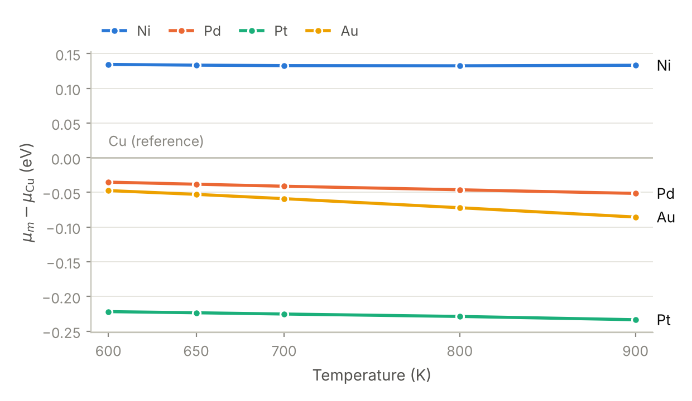
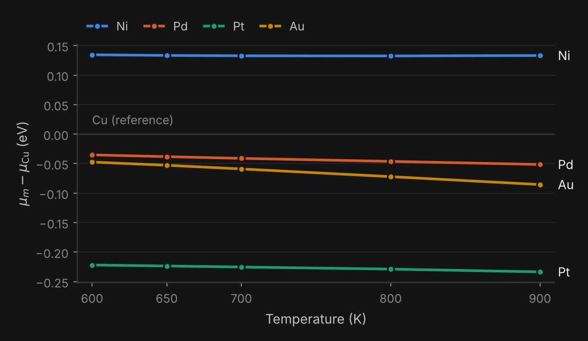

Quickstart
==========

This page runs a complete CatEMC study in about a minute: a Gibbs-ensemble
simulation of a small Cu\ :sub:`0.25`\ Ni\ :sub:`0.25`\ Pd\ :sub:`0.2`\ Pt\
:sub:`0.2`\ Au\ :sub:`0.1` alloy that gives the chemical-potential
differences between the five metals. It uses the EMT calculator that ships
with ASE, so it needs no GPU and no machine-learning potential.

.. note::

   EMT and a 32-atom cell make this example fast. The numbers are a toy
   result. The :doc:`tutorials` use production settings and the MACE-MPA-0
   foundation model.

The command-line version needs nothing but ``pip install catemc``. The files
of this page are also in ``examples/quickstart`` of the
`GitHub repository <https://github.com/basf/CatEMC>`_, and the Python version
is shown in full below.

Run it
------

.. tab-set::
   :sync-group: interface

   .. tab-item:: Command line
      :sync: cli

      Write a commented starting configuration, then run the three stages:

      .. code-block:: console

         $ catemc init gibbs
         Wrote config.yaml. Edit it, then run:
           catemc generate config.yaml
           catemc run config.yaml
           catemc analyze config.yaml
         $ catemc generate config.yaml
         $ catemc run config.yaml
         $ catemc analyze config.yaml

      ``catemc init`` also writes starting files for the other two ensembles:
      ``catemc init canonical`` and ``catemc init grand_canonical``.

   .. tab-item:: Python
      :sync: python

      .. code-block:: console

         $ cd examples/quickstart
         $ python quickstart.py

      .. literalinclude:: ../../examples/quickstart/quickstart.py
         :language: python
         :lines: 15-

What the three stages do
------------------------

Structure generation
^^^^^^^^^^^^^^^^^^^^

``catemc generate`` builds the template lattice, decorates it randomly at the
requested composition, and gives every replica a temperature:

.. code-block:: console

   $ catemc generate config.yaml
   Random seed: 1
   Replica   0  T = 600 K  Au3Cu8Ni8Pd7Pt6
   Replica   1  T = 600 K  Au3Cu8Ni8Pd7Pt6
   Replica   2  T = 700 K  Au3Cu8Ni8Pd7Pt6
   Replica   3  T = 700 K  Au3Cu8Ni8Pd7Pt6
   Replica   4  T = 800 K  Au3Cu8Ni8Pd7Pt6
   Replica   5  T = 800 K  Au3Cu8Ni8Pd7Pt6
   Replica   6  T = 900 K  Au3Cu8Ni8Pd7Pt6
   Replica   7  T = 900 K  Au3Cu8Ni8Pd7Pt6
   Wrote 8 replicas to CuNiPdPtAu_bulk_input_pop.traj

The population has two replicas at each of four temperatures. Two replicas
per temperature is the minimum for the Gibbs ensemble, because replicas at
the same temperature exchange atoms with each other.

EMC simulation
^^^^^^^^^^^^^^

``catemc run`` starts the worker processes, evaluates the initial population
and performs 100 EMC steps. In every step each replica is changed by one
Monte Carlo move and relaxed, and every tenth step the replicas are also
propagated by a short molecular-dynamics run. The last line of each step
summarizes it:

.. code-block:: text

   Generation 100: acceptance 6/8 (0.750), best_raw_score 0.82903473, elapsed 0.7 min

Running the same command again continues from the last completed step, so a
longer simulation only needs a larger ``run.total_steps``:

.. code-block:: console

   $ catemc run config.yaml -s run.total_steps=300

Post-simulation analysis
^^^^^^^^^^^^^^^^^^^^^^^^

``catemc analyze`` reweights the samples of all temperatures with MBAR and
prints the chemical-potential differences
:math:`\dmu{A}{B} = \mu_\mathrm{B} - \mu_\mathrm{A}`, listed as ``A2B``, at the
simulated temperatures and at any other temperature you ask for (650 K here):

.. code-block:: console

   $ catemc analyze config.yaml
   Wrote the trajectory of replica 0.
   Wrote CuNiPdPtAu_bulk_mbar_diagnostics.pkl
   Wrote the Warren-Cowley short-range order parameters.
   Metal chemical-potential differences mu_B - mu_A (eV), listed as 'A2B':
     600 K: Cu2Ni 0.135, Cu2Pd -0.029, Cu2Pt -0.220, Cu2Au -0.054, Ni2Pd -0.163, ...
     650 K: Cu2Ni 0.136, Cu2Pd -0.028, Cu2Pt -0.217, Cu2Au -0.054, Ni2Pd -0.163, ...
     700 K: Cu2Ni 0.136, Cu2Pd -0.027, Cu2Pt -0.216, Cu2Au -0.055, Ni2Pd -0.164, ...
     800 K: Cu2Ni 0.137, Cu2Pd -0.029, Cu2Pt -0.214, Cu2Au -0.060, Ni2Pd -0.166, ...
     900 K: Cu2Ni 0.138, Cu2Pd -0.031, Cu2Pt -0.213, Cu2Au -0.067, Ni2Pd -0.169, ...
   Wrote CuNiPdPtAu_bulk_mbar_dmu_estimates.pkl

   Chemical potentials relative to Cu from the quickstart run (EMT, 32-atom
   cell, 100 steps).

   Chemical potentials relative to Cu from the quickstart run (EMT, 32-atom
   cell, 100 steps).

Your numbers will differ in the second decimal, because the worker processes
do not share one random-number stream. A run this short carries a statistical
error of about 0.01 to 0.02 eV.

The files that were written
---------------------------

.. list-table::
   :header-rows: 1
   :widths: 44 56

   * - File
     - Content
   * - ``CuNiPdPtAu_bulk_template.traj``
     - the undecorated lattice (command line only)
   * - ``CuNiPdPtAu_bulk_input_pop.traj``
     - the initial population (command line only)
   * - ``CuNiPdPtAu_bulk.db``, ``..._bak0.db``, ...
     - ASE databases with every accepted and attempted structure. Old steps
       are moved to the backup files every ``trim_generation`` steps.
   * - ``CuNiPdPtAu_bulk.log``
     - the population after every step
   * - ``CuNiPdPtAu_bulk_mbar_dmu_estimates.pkl``
     - ``{temperature: {'A2B': mu_B - mu_A}}`` in eV
   * - ``CuNiPdPtAu_bulk_sro_data.pkl``
     - Warren-Cowley short-range order parameters per temperature
   * - ``CuNiPdPtAu_bulk_geemc_0.traj``
     - the trajectory of replica 0
   * - ``CuNiPdPtAu_bulk_mbar_*.pkl``
     - cached samples, reused by the next analysis

The configuration file
----------------------

Everything the three commands did is described by ``config.yaml``:

.. literalinclude:: ../../examples/quickstart/config.yaml
   :language: yaml
   :lines: 12-

Two commands help while you edit this file:

.. code-block:: console

   $ catemc check config.yaml                    # show what the file resolves to
   $ catemc run config.yaml -s emc.procs_per_device=4   # replace one entry

Where to go next
----------------

.. grid:: 1 2 2 2
   :gutter: 3

   .. grid-item-card:: Method
      :link: concepts
      :link-type: doc
      :class-card: sd-card-hover

      What the replicas, the moves and the reweighting do.

   .. grid-item-card:: Tutorials
      :link: tutorials
      :link-type: doc
      :class-card: sd-card-hover

      A high-entropy alloy and a high-entropy oxide, bulk and surface.

   .. grid-item-card:: Use your own potential
      :link: cli
      :link-type: doc
      :class-card: sd-card-hover

      Replace the ``calculators`` section by MACE or any ASE calculator.

   .. grid-item-card:: Every key of the file
      :link: config_reference
      :link-type: doc
      :class-card: sd-card-hover

      The complete reference of the configuration file.
