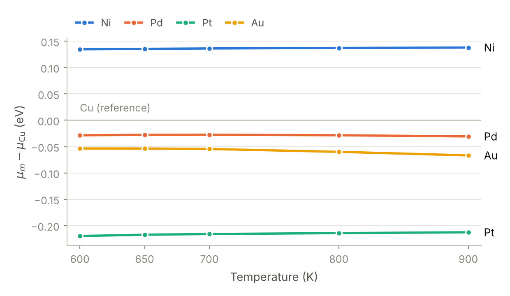
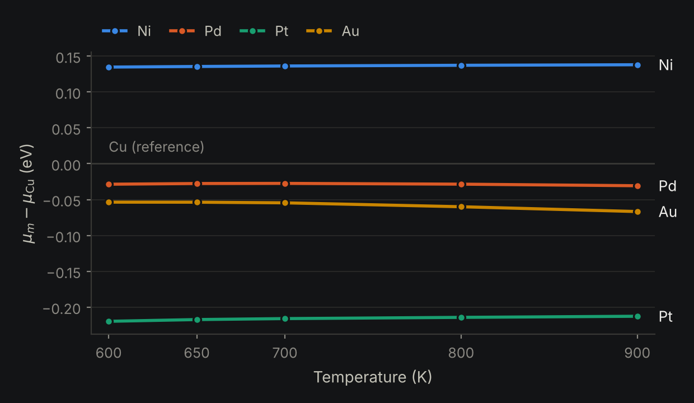
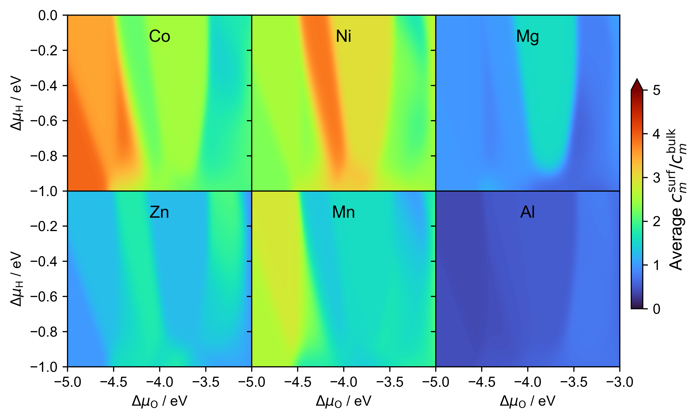
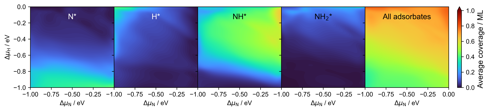
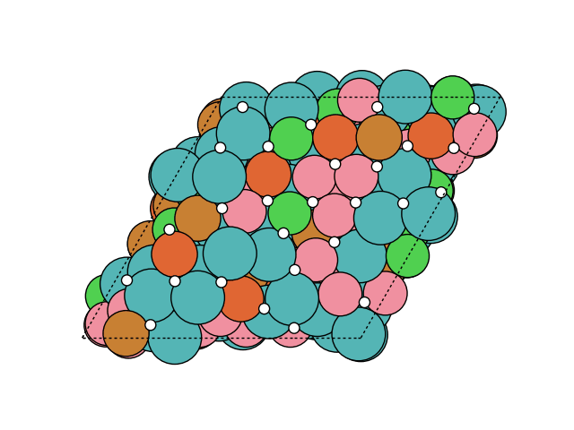

Visualization
=============

The analysis writes ordinary pickle and NumPy files (:doc:`analysis`), so
every figure is a short Matplotlib script. This page gives one recipe per
kind of result. Each recipe works on the files of a command-line run and of
a Python run alike.

.. list-table::
   :header-rows: 1
   :widths: 44 56

   * - Result
     - File it is drawn from
   * - :ref:`Chemical potentials against temperature <viz-dmu>`
     - ``{name}_mbar_dmu_estimates.pkl``
   * - :ref:`Short-range order matrix <viz-sro>`
     - ``{name}_sro_data.pkl``
   * - :ref:`Surface phase diagrams <viz-spd>`
     - ``{name}_mbar_expectations.pkl``
   * - :ref:`Most stable surface structures <viz-stable>`
     - ``{name}_mbar_fes.pkl`` and ``{name}_mbar.traj``
   * - :ref:`Movies of a replica <viz-movie>`
     - ``{name}_geemc_{replica}.traj``, ``{name}_gcemc_{replica}.traj``

.. _viz-dmu:

Chemical potentials against temperature
---------------------------------------

The bulk analysis stores ``{temperature: {'A2B': mu_B - mu_A}}``. Choosing
one metal as the reference gives one line per remaining metal:

.. code-block:: python

   import matplotlib.pyplot as plt
   import pickle

   name = 'CuNiPdPtAu_bulk'
   reference = 'Cu'

   with open(f'{name}_mbar_dmu_estimates.pkl', 'rb') as handle:
       dmu = pickle.load(handle)             # {T: {'A2B': mu_B - mu_A}}

   temperatures = sorted(dmu)
   fig, ax = plt.subplots(figsize=(4.5, 3.2), constrained_layout=True)
   for key in dmu[temperatures[0]]:
       first, second = key.split('2')
       if first == reference:
           ax.plot(temperatures, [dmu[T][key] for T in temperatures],
                   marker='o', label=second)
   ax.axhline(0, color='0.6', lw=0.8)
   ax.set_xlabel('Temperature (K)')
   ax.set_ylabel(rf'$\mu_m - \mu_{{\mathrm{{{reference}}}}}$ (eV)')
   ax.legend(frameon=False)
   fig.savefig(f'{name}_dmu.png', dpi=200)

   The result of the :doc:`quickstart` run. A metal below the zero line
   is bound more strongly in the alloy than the reference metal.

   The result of the :doc:`quickstart` run. A metal below the zero line
   is bound more strongly in the alloy than the reference metal.

.. _viz-sro:

Short-range order matrix
------------------------

``{name}_sro_data.pkl`` holds the Warren-Cowley parameters
(:eq:`eq-sro`) of every analysed step. Averaging them and filling a
symmetric matrix shows at a glance which pairs attract (negative, blue)
and which avoid each other (positive, red):

.. code-block:: python

   import matplotlib.pyplot as plt
   import numpy as np
   import pickle

   name = 'CuNiPdPtAu_bulk'
   metals = ['Cu', 'Ni', 'Pd', 'Pt', 'Au']
   T = 600

   with open(f'{name}_sro_data.pkl', 'rb') as handle:
       sro = pickle.load(handle)             # {T: {(m, n): [array per step]}}

   alpha = np.full((len(metals), len(metals)), np.nan)
   for (m, n), arrays in sro[T].items():
       i, j = metals.index(m), metals.index(n)
       alpha[i, j] = alpha[j, i] = np.nanmean(np.concatenate(arrays))

   fig, ax = plt.subplots(figsize=(3.6, 3), constrained_layout=True)
   limit = np.nanmax(np.abs(alpha))
   image = ax.imshow(alpha, cmap='RdBu_r', vmin=-limit, vmax=limit)
   ax.set_xticks(range(len(metals)), metals)
   ax.set_yticks(range(len(metals)), metals)
   for (i, j), value in np.ndenumerate(alpha):
       ax.text(j, i, f'{value:.2f}', ha='center', va='center', fontsize=8)
   fig.colorbar(image, label=r'Warren-Cowley $\alpha_{mn}$')
   fig.savefig(f'{name}_sro_{T}K.png', dpi=200)

The colour scale is symmetric around zero, so white always means a random
arrangement.

.. _viz-spd:

Surface phase diagrams
----------------------

Every array of ``{name}_mbar_expectations.pkl`` has one value per reaction
condition. The conditions themselves are the rows of the array that was
passed to the analysis: the chemical-potential columns in the order of
``element_column_map``, then the temperature. The command line saves this
array as ``{name}_mbar_expectations_conditions.npy``, so the plot can
select its rows directly:

.. code-block:: python

   import matplotlib.pyplot as plt
   import numpy as np
   import pickle
   from matplotlib.colors import TwoSlopeNorm

   name = 'Co0.25Mo0.45Fe0.1Ni0.1Cu0.1NH_111'
   bulk = {'Co': 0.25, 'Mo': 0.45, 'Fe': 0.1, 'Ni': 0.1, 'Cu': 0.1}
   T = 800

   with open(f'{name}_mbar_expectations.pkl', 'rb') as handle:
       expectations = pickle.load(handle)
   # one row per reaction condition: dmu_N, dmu_H, T
   conditions = np.load(f'{name}_mbar_expectations_conditions.npy')

   rows = np.where(np.isclose(conditions[:, -1], T))[0]
   x, y = conditions[rows, 0], conditions[rows, 1]

   fig, axes = plt.subplots(1, len(bulk), figsize=(2.6 * len(bulk), 2.8),
                            sharey=True, constrained_layout=True)
   norm = TwoSlopeNorm(vmin=-1, vcenter=0, vmax=1)
   for ax, (metal, c_bulk) in zip(axes, bulk.items()):
       ratio = np.clip(expectations[f'x_surf_{metal}'][rows] / c_bulk, 1e-9, None)
       mesh = ax.tricontourf(x, y, np.log2(ratio), levels=np.linspace(-1, 1, 41),
                             cmap='RdBu_r', norm=norm, extend='both')
       ax.set_title(metal)
       ax.set_xlabel(r'$\Delta\mu_{\mathrm{N}}$ (eV)')
   axes[0].set_ylabel(r'$\Delta\mu_{\mathrm{H}}$ (eV)')
   fig.colorbar(mesh, ax=axes, ticks=[-1, 0, 1],
                label=r'$\log_2(c^{\mathrm{surf}} / c^{\mathrm{bulk}})$')
   fig.savefig(f'{name}_metals_{T}K.png', dpi=200)

The colour is the logarithm of the surface enrichment, so a metal that is
twice as concentrated at the surface as in the bulk (+1) and one that is
half as concentrated (−1) are equally far from white.

.. admonition:: After a Python analysis
   :class: catemc-cli

   ``get_structural_expectations`` does not save the conditions. Build
   ``conditions`` with exactly the lines of your analysis script, including
   the order of the temperatures, or save the array there with
   ``np.save``. A grid built with the temperatures in another order
   selects the rows of another temperature without any error message.

   Surface metal phase diagram of the HEO(311) surface at 1023 K, drawn
   with ``plot_metals_spd_muO_vs_muH.py``. The star marks the
   H\ :sub:`2`-reduction condition.

Adsorbate coverages are drawn in the same way from ``ads_coverage`` and
``ads_coverage_{fragment}``. A coverage is a magnitude with no neutral
midpoint, so use a sequential colour map and a common range for all
panels:

.. code-block:: python

   fragments = ['N', 'H', 'NH', 'NH2']
   fig, axes = plt.subplots(1, len(fragments) + 1, sharey=True,
                            figsize=(2.6 * (len(fragments) + 1), 2.8),
                            constrained_layout=True)
   keys = [f'ads_coverage_{f}' for f in fragments] + ['ads_coverage']
   for ax, key, title in zip(axes, keys, fragments + ['All adsorbates']):
       mesh = ax.tricontourf(x, y, expectations[key][rows],
                             levels=np.linspace(0, 1, 41), cmap='viridis',
                             extend='max')
       ax.set_title(title)
       ax.set_xlabel(r'$\Delta\mu_{\mathrm{N}}$ (eV)')
   axes[0].set_ylabel(r'$\Delta\mu_{\mathrm{H}}$ (eV)')
   fig.colorbar(mesh, ax=axes, label='Coverage (ML)')

   Adsorbate phase diagram of the HEA(111) surface, drawn with
   ``plot_adsorbates_spd_muN_vs_muH.py``.

To mark a reaction condition in a diagram, convert its absolute chemical
potentials to the axes of the plot with the reference energies:
:math:`\Delta\mu_\mathrm{N} = \mu_\mathrm{N} - E_\mathrm{N}^\mathrm{ref}`
(:eq:`eq-dmu-element`), then ``ax.plot(dmu_N, dmu_H, marker='*')``.

.. _viz-stable:

Most stable surface structures
------------------------------

``{name}_mbar_fes.pkl`` assigns every sampled structure a free energy at
each requested condition (:eq:`eq-fes`). The structure with the lowest
value is the most probable surface phase there, and
``{name}_mbar.traj`` contains the structures in the same order:

.. code-block:: python

   import numpy as np
   import pickle
   from ase.io import read, write

   name = 'Co0.25Mo0.45Fe0.1Ni0.1Cu0.1NH_111'

   with open(f'{name}_mbar_fes.pkl', 'rb') as handle:
       fes = pickle.load(handle)['all']      # (structures, reaction conditions)
   structures = read(f'{name}_mbar.traj', index=':')

   # columns that were evaluated (sample_condition_indices)
   for column in np.where(~np.isnan(fes).all(axis=0))[0]:
       best = int(np.nanargmin(fes[:, column]))
       print(column, structures[best].get_chemical_formula())
       write(f'{name}_stable_{column}.png', structures[best],
             rotation='-70x', scale=40)

The columns follow the rows of the reaction conditions of the ``fes`` task
(``{name}_mbar_fes_conditions.npy`` on the command line). Open the
structures with ``ase gui`` to inspect them interactively:

.. code-block:: console

   $ ase gui Co0.25Mo0.45Fe0.1Ni0.1Cu0.1NH_111_mbar.traj

.. _viz-movie:

Movies of a replica
-------------------

``get_trajectory`` (``analysis.trajectory`` on the command line) follows
one replica through the exchanges and writes the structure it had at every
step. ASE turns it into an animation:

.. code-block:: python

   from ase.io import read, write

   name = 'Co0.25Mo0.45Fe0.1Ni0.1Cu0.1NH_111'
   images = read(f'{name}_gcemc_10.traj', index='::10')    # every tenth step
   write(f'{name}_gcemc_10.gif', images, rotation='-70x', interval=200)

   Replica 10 of the HEA(111) run: metals segregate and the adlayer
   changes while the replica walks through temperatures and chemical
   potentials.

The plotting scripts of the examples
------------------------------------

The scripts that drew the figures of the paper are next to the examples.
They rebuild the grid of reaction conditions in the script, so the grid
has to match the one of the corresponding ``mbar_analysis*.py``.

.. list-table::
   :header-rows: 1
   :widths: 30 34 36

   * - Folder
     - Script
     - Figure
   * - ``Co0.25Mo0.45Fe0.1Ni0.1Cu0.1/111``
     - ``plot_metals_spd_muN_vs_muH.py``
     - surface metal fractions against
       :math:`\Delta\mu_\mathrm{N}` and :math:`\Delta\mu_\mathrm{H}`
   * -
     - ``plot_adsorbates_spd_muN_vs_muH.py``
     - coverage of every fragment
   * -
     - ``plot_surf_bond_matrix.py``
     - numbers of bonds between the surface species at one condition
   * - ``Co0.2Ni0.2Mg0.2Zn0.2Mn0.2Al2O3.5/311``
     - ``plot_metals_spd_muO_vs_muH.py``, ``plot_metals_spd_muO_vs_muC.py``
     - surface metal fractions under H\ :sub:`2` and CO reduction
   * -
     - ``plot_adsorbates_spd_muO_vs_muH.py``,
       ``plot_adsorbates_spd_muO_vs_muC.py``
     - coverage of every fragment
   * -
     - ``plot_Ovac_spd_muO_vs_muH.py``
     - fraction of lattice-oxygen vacancies
   * -
     - ``plot_surf_bond_matrix_OH.py``, ``plot_surf_bond_matrix_COH.py``
     - numbers of bonds between the surface species at one condition
