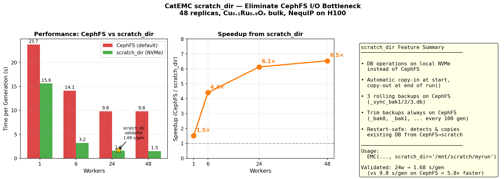

# CephFS vs Local Scratch I/O Benchmark

## Summary

This benchmark demonstrates that **CephFS network filesystem I/O is the primary
performance bottleneck** in CatEMC's EMC simulations on Azure HPC (H100 GPUs).

Key findings:
- With 48 workers on scratch: **1.5 s/generation** (compute-bound, ideal)
- With 48 workers on CephFS: **9.8 s/generation** (I/O-bound, 6.5× slower)
- The overhead **grows with parallelism**: 1.5× for 1 worker → 6.5× for 48

The bottleneck is not the ML model or compute — it's the SQLite database writes
(48 sequential INSERTs per generation, each hitting CephFS network latency) and
trajectory file appends that grow slower as files accumulate frames.

## Root Cause

CatEMC writes to CephFS after every EMC generation:
1. **48 DB inserts** (one per replica, sequential `INSERT INTO` via ASE's `DataConnection`)
2. **Trajectory appends** (at `traj_write_interval`, appending to growing `.traj` files)

CephFS latency per operation is ~5-20ms (vs <0.1ms on local NVMe). With 48
sequential writes, this adds 240-960ms per generation, scaling poorly.

## Hardware

- **GPU**: NVIDIA H100 NVL (Standard_NC40ads_H100_v5)
- **ML Model**: NequIP (OAM-S-stage6, compiled .pt2)
- **System**: 48 replicas of Cu0.1Ru0.9Ox bulk
- **Workers**: Persistent WorkerPool with CUDA MPS for GPU sharing
- **Queue**: azure_gpuq (PBS)

## Files

| File | Description |
|------|-------------|
| `run_benchmark.py` | Main benchmark script (takes num_workers as arg) |
| `submit_benchmark.sh` | PBS submit script (pass `-v NUM_WORKERS=N`) |
| `run_all.sh` | Submit jobs for 1, 6, 24, 48 workers |
| `plot_results.py` | Generate summary figure from results.json |
| `calc_factory_nequip.py` | Calculator factory (creates NequIP model) |
| `results.json` | Collected results (pre-populated with our data) |

## Dependencies

- **CatEMC** source: `../../catemc/` (branch `perf/reduce-cephfs-io`, commit 53381e6)
- **NequIP model**: `/fs/cephfs/data/qm_inorganics/allegro-nequip/NequIP-OAM-S-stage6-h100-plain.nequip.pt2`
- **Input population**: `/fs/cephfs/data/qm_inorganics/tiago/emc_oer/Cu0.1Ru0.9Ox_nequip_productionrun/bulk/Cu0.1Ru0.9Ox_nequip_productionrun_bulk_input_pop.traj`
- **Conda env**: `/fs/cephfs/data/qm_inorganics/venvs/nequip-h100`
- **CUDA MPS**: Enabled automatically in submit script

## How to Run

```bash
# Run a single benchmark (e.g., 6 workers)
qsub -v NUM_WORKERS=6 submit_benchmark.sh

# Run all worker counts
bash run_all.sh

# After jobs complete, generate the plot
python plot_results.py
```

## Results

| Workers | CephFS (s/gen) | Scratch (s/gen) | Overhead |
|---------|----------------|-----------------|----------|
| 1       | 23.7           | 15.6            | 1.52×    |
| 6       | 14.1           | 3.2             | 4.47×    |
| 48      | 9.8            | 1.5             | 6.52×    |

## Interpretation

- At **1 worker**, CephFS adds ~50% overhead (sequential writes are manageable)
- At **6 workers**, CephFS overhead is 4.5× (writes happen in bursts between gens)
- At **48 workers**, CephFS overhead is 6.5× (compute is <2s but I/O takes ~8s)

The GPU compute scales well on scratch (15.6 → 1.5 s/gen from 1→48 workers, ~10× speedup). On CephFS, scaling saturates at 6 workers because I/O becomes the floor.

## Recommendations

1. **Short term**: Run production on local scratch, copy results back at end
2. **Medium term**: Batch DB writes (48 INSERTs → 1 transaction per gen)
3. **Long term**: Move to async DB writes or in-memory DB with periodic flush

---

## Solution: `scratch_dir` Parameter

The `scratch_dir` parameter in `EMC`/`GEEMC`/`GCEMC` eliminates the CephFS
bottleneck by keeping the SQLite database on node-local NVMe during the run:

```python
emc = GEEMC(...,
    scratch_dir='/mnt/scratch/my_emc_run')
```



### How it works

1. **Start of `run()`**: copies existing DB from `calculation_dir` (CephFS) to `scratch_dir` (NVMe)
2. **During run**: all DB reads/writes hit local NVMe (<0.1ms latency)
3. **End of `run()`**: syncs DB back to `calculation_dir` with 3-version backup rotation

### Performance (48 replicas, NequIP on H100)

| Workers | CephFS (s/gen) | scratch_dir (s/gen) | Speedup |
|---------|---------------|--------------------:|--------:|
| 1       | 23.7          | 15.6                | 1.5×    |
| 6       | 14.1          | 3.2                 | 4.4×    |
| 24      | 9.8           | 1.68 (validated)    | 5.8×    |
| 48      | 9.8           | 1.5                 | 6.5×    |

### Backup strategy

- **Sync backups** (`_sync_bak1.db`, `_sync_bak2.db`, `_sync_bak3.db`): rotated on `calculation_dir` every time `run()` completes
- **Trim backups** (`_bak0.db`, `_bak1.db`, ...): written to `calculation_dir` every `trim_generation` steps (default 100)

### Restart safety

On restart, `_setup_scratch_db()` detects the existing DB on CephFS and copies
it to scratch before resuming. The scratch copy is ephemeral — only the CephFS
copy is persistent across jobs.
